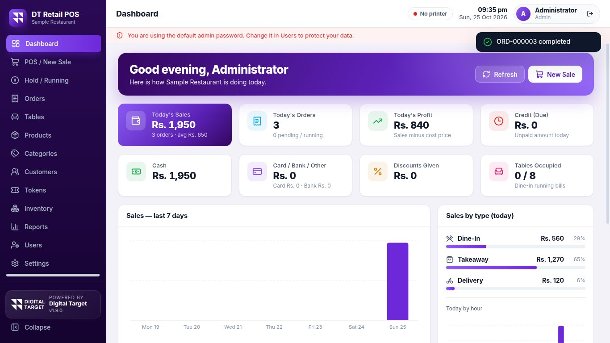
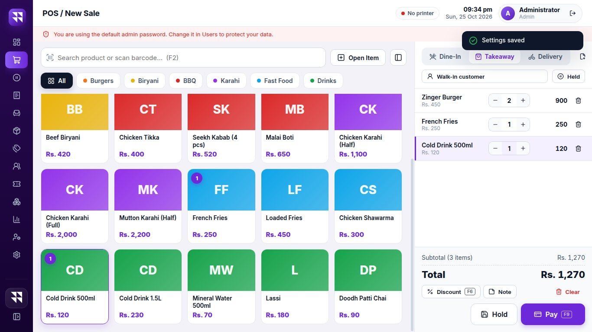
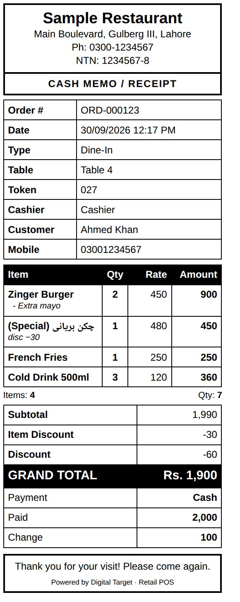
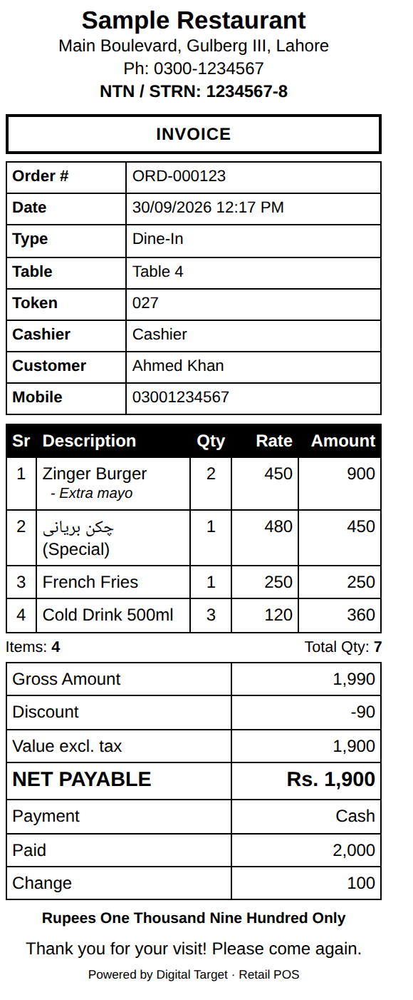
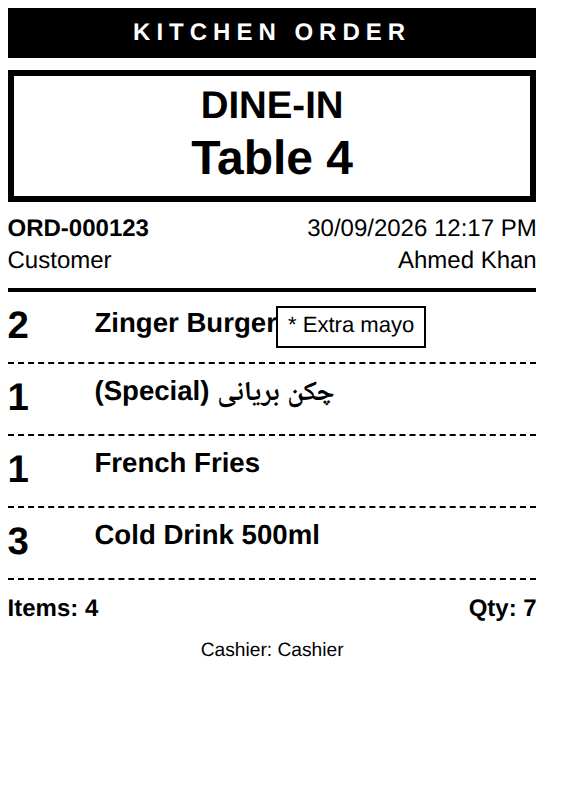
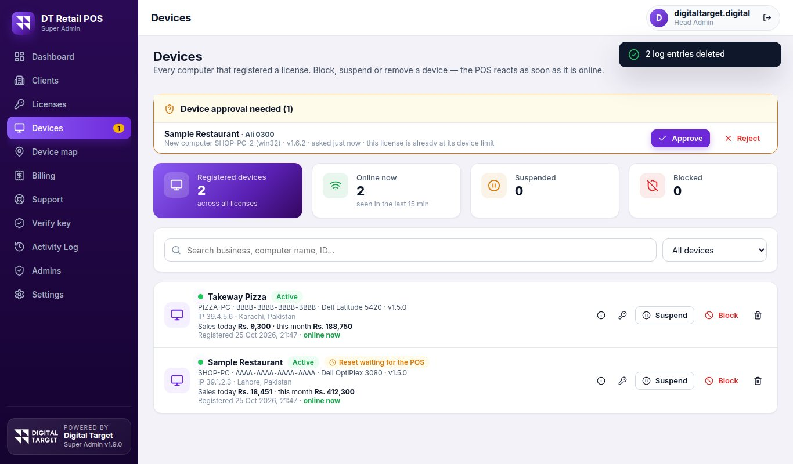
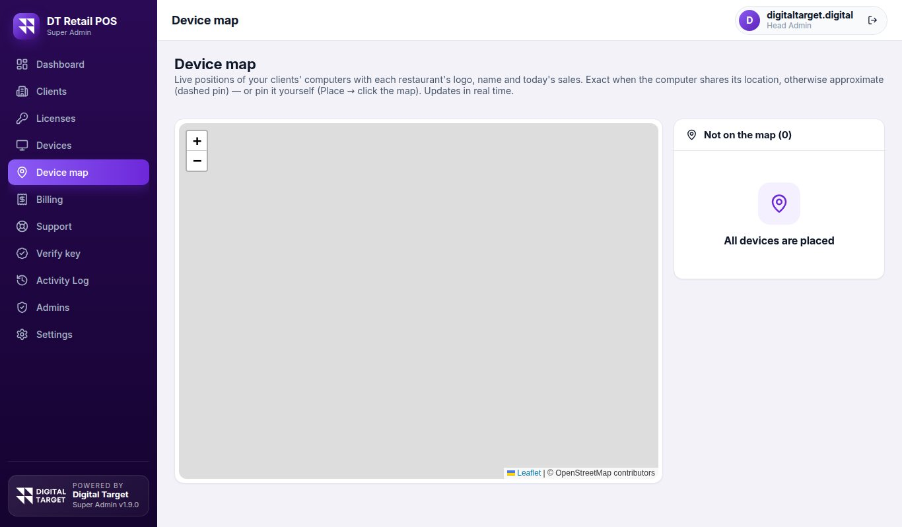

# DT Retail POS — System Details (Mukammal Tafseel)

**Version 1.9.0 · Developed by Digital Target · digitaltarget.digital@gmail.com**

Yeh document **DT Retail POS** system ki poori tafseel hai: yeh kya hai, kya kya kar sakta hai, kaise kaam karta hai, license aur security ka nizam, technical dhancha, kya test hua aur kya abhi baqi hai. Is ko owner, investor, ya technical team — sab padh sakte hain. Roz ke istemaal ka tareeqa alag document **User Guide** (`DT_RETAIL_POS_USER_GUIDE.pdf`) mein hai.

---

## 1. Ek nazar mein

| Cheez | Tafseel |
|---|---|
| **Naam** | DT Retail POS (Simple Offline POS for Small Businesses) |
| **Kis ke liye** | Pakistan ke restaurants, dhabe, biryani / burger points, fast food, cafés, bakery, kiryana aur chhoti dukaanein |
| **Platform** | Windows 10 / 11 (64-bit) desktop software |
| **Internet** | Billing, printing, reports **poori tarah offline**. Internet sirf pehli license activation, provider ke paigham aur license ke online check ke liye |
| **Database** | SQLite (computer ke andar), WAL mode, har sale ek transaction mein |
| **Zabaan** | English interface; Urdu (Nastaliq / Naskh) naam, items, bill par poori tarah supported |
| **Bill printer** | 58 mm aur 80 mm thermal (USB / Bluetooth / network) — direct ESC/POS printing |
| **Sale ki qismein** | Dine-In (table), Takeaway, Delivery |
| **Receipt designs** | 11 bill designs, 5 token designs, kitchen slip (KOT), 17 reports |
| **Themes** | 7 (Royal Purple default, Crimson, Black & Gold, Emerald, Sunset, Ocean, Night) |
| **License** | Mandatory, digitally signed (ECDSA), device limit, live control provider ke Super Admin panel se |
| **Super Admin panel** | Alag web panel (Firebase) — clients, licenses, devices, map, billing, support |
| **Developer** | Digital Target |



---

## 2. System ke do hisse

```
  RESTAURANT KA COMPUTER                          PROVIDER (Digital Target)
+--------------------------------+              +--------------------------------+
| DT Retail POS (Windows app)    |   internet   | Super Admin Panel (web)        |
| - Billing, tables, tokens      |(zaroorat par)| - Clients, Licenses            |
| - Printing (ESC/POS)           |  -------->   | - Devices + Map                |
| - Inventory, Reports           |  <--------   | - Billing / Invoices           |
| - Backup / Restore             |license check | - Support, Audit log           |
| - SQLite database (local)      |device status | - Firebase Auth + Firestore    |
| - license.json (local)         |              |                                |
+--------------------------------+              +--------------------------------+

  Data restaurant ke computer par hi rehta hai.
```

- **POS app** — restaurant ka asal software. Sab data (menu, sales, customers) usi computer par.
- **Super Admin panel** — sirf provider ka web page. Is mein client ka **business data nahi** hota; sirf client ki maloomat, license, computer ki detail aur support ke paigham.

---

## 3. POS ke modules — kya kya milta hai

| Module | Tafseel |
|---|---|
| **Login** | 4 ankon ka **PIN** (tile par click) ya username / password. Har sale par cashier, tareekh, waqt. 5 ghalat koshishon ke baad 30 second ka lock. **Forgot password or PIN?** — provider se reset (8.6). |
| **Dashboard** | Aaj ki sale, orders, profit, cash / card / bank, udhaar, dine-in / takeaway / delivery ka hissa, pending orders, bhari tables, low stock, top items, 7 din aur ghanton ke charts. |
| **POS / New Sale** | Search + barcode (F2), categories (**top line + "⋯ +n"** ya **left rail**), product cards tasveer ke saath, cart (qty, item discount, note), bill discount (Rs. / %), Open Item, tax, delivery charges, round-off, hold / resume, tez payment, udhaar sales, auto print. |
| **Sale types** | **Dine-In** (table, waiter, running bill, KOT, bill print, settle), **Takeaway** (token), **Delivery** (customer naam / mobile / address, rider, charges). |
| **Variants (sizes)** | Small / Medium / Large — har size ki apni qeemat, tap par chunna. |
| **Weighed items (kg)** | Right-side **number pad**: wazan likhein ya rupay likhein; qeemat = miqdar × per-kg rate; gram tak (3 decimal). |
| **Recipe management** | Dish ki recipe (ingredients); har sale par ingredient ka stock khud kam, cost recipe se; size ke hisaab se factor. |
| **Deals / Combos** | Ek qeemat par kai items; components ka stock khud kam. |
| **Tables** | Floor plan, **floors**, **Move (transfer)**, **Merge**, **Split**, **Free**, **Reserve**, dine-in history. POS ke table picker mein floors ke hisaab se group. |
| **Hold / Running** | Hold kiye hue aur chalte hue dine-in bills ek jagah; Retrieve, KOT, bill print, cancel. |
| **Orders** | Search aur filters; tafseel, reprint, token, **Receive due**, cancel, refund (stock wapas), open in POS. |
| **Tokens** | Khud numbers (001, 002…), daily reset ya continuous; Combined / Per Item / No Token; kitchen board (Preparing → Ready → Collected). |
| **Products** | Naam (Urdu), SKU, barcode, category, sale / cost price, discount, unit, stock, low alert, image (khud resize), variants, recipe, weighed, ingredient, active. |
| **Categories** | Colour, icon, sort order, POS par dikhana / chhupana. |
| **Customers** | Naam, mobile, address, notes, khareed ki history, kul kharch, baqaya (Due). Delivery aur udhaar se khud ban jate hain. |
| **Inventory** (optional) | On / off. Stock In (weighted average cost), Out, Adjust, history, stock value, low / out of stock. Sale se kam, refund se wapas. |
| **Waiters & Riders** | Dine-in mein waiter, delivery mein rider; bill, KOT, token aur reports mein naam. |
| **Reports** | 17 reports, Print / PDF / CSV / Excel, 80 mm thermal print aur PNG. |
| **Users** | Admin, Manager, Cashier, Kitchen, Delivery + custom ijazatein. |
| **Payments** | Cash, Card, Bank, Other, Credit (udhaar). Bank accounts (HBL, Meezan, JazzCash…) bill par chhapte hain. |
| **Printing** | Seedha thermal ESC/POS, 11 receipt designs, 5 token designs, KOT, QR, amount in words, margins, cash drawer. |
| **Bulk tools** | Excel / CSV se poora menu import (template), tasveerein file naam se ek saath. |
| **Backup & Restore** | Backup now / USB, roz ka auto backup, restore (safety copy), **Excel (.xlsx) aur JSON export / import — poora data**. |
| **Appearance** | 7 themes, promo banner, splash, animated login. |
| **License & Support** | License ki halat, provider se chat, device location ka card. |



---

## 4. Billing ka tareeqa (hisaab kaise banta hai)

Bill ka hisaab **ek hi formula** se, screen aur database dono mein bilkul ek jaisa:

```
Subtotal      = Σ (qty × unit price)
Item discount = Σ (qty × per-unit discount)
Net           = Subtotal − Item discount
Bill discount = Rs. ya % (Net se zyada nahi ho sakta)
Taxable       = Net − Bill discount
Tax           = Taxable × tax rate %        (agar tax on ho)
Delivery      = delivery charges
Total         = Taxable + Tax + Delivery    (Round-off on ho to poore rupay)
```

- **Payment:** Received − Total = **Change**; Received < Total = baqi **Due (Credit)** (customer zaroori, "Allow credit" on).
- **Order numbers** (ORD-000001…) aur **token numbers** gap-free, ek transaction ke andar bante hain; prefix aur digits tabdeel ho sakte hain.
- **Quantity** 3 decimal tak (1.375 kg).
- **Stock:** sale par stock kam (recipe / deal ke components ke saath), refund par wapas. Restaurant ke liye "Allow selling when out of stock" on rakha ja sakta hai.
- **Profit:** har item ki cost (ya recipe ki cost) bill ke waqt save hoti hai, is liye baad mein cost badalne se purana profit nahi badalta.

---

## 5. Printing ka nizam

| Cheez | Tafseel |
|---|---|
| **Method** | **Thermal (ESC/POS)**: bill ko tasveer bana kar seedha printer ko bheja jata hai — **upar khali kagaz nahi**, sahi lambai, sahi cut, foran print. **Windows driver** ka tareeqa bhi maujood. |
| **Auto-detect** | Installed printers khud dhoondta hai, tayyar rakhta hai (keep-alive), nakam hone par dobara koshish, status pill (hara / laal). |
| **Print verification** | Pehle bill se pehle receipt aur kitchen printer ki jaanch. |
| **Receipt designs (11)** | Classic, Modern, Minimal, Restaurant, Retail Invoice, Compact, Boxed Grid, Bold Restaurant, Tax Invoice + QR, Luxury, Ticket. |
| **Token designs (5)** | Classic, Boxed, Bold Number, Minimal, Ticket. |
| **KOT** | Kitchen slip: sirf items (qeemat nahi), table, waiter / rider, note. |
| **Margins** | Top / bottom, **left = right hamesha barabar**, aur printer ka **Side balance** (dots) + **Margin test**. |
| **Extras** | Logo, QR (website / JazzCash), amount in words, bank account details, NTN / STRN, Urdu font, copies, cash drawer kick. |
| **Reports** | 58 / 80 mm thermal par chhota print, ya PNG; A4 par PDF. |

  

---

## 6. Reports

| Group | Reports |
|---|---|
| Sales | Day Summary (Z Report), Sales Report, Order Report, Dine-In Sales, Takeaway Sales, Delivery Sales |
| Items | Product Sales, Category Sales |
| Money | Payment Report, Credit / Due Report, Discount Report, Profit Report |
| Staff | Cashier Report, Waiter Report, Rider Report |
| Stock | Inventory Report, Stock Movements |

Tareekh ka daira (aaj, haftawar, mahana, custom). Export: **Print, PDF, CSV, Excel (.xlsx), 80 mm print, PNG**.

---

## 7. Users, ijazatein aur hifazat

| Role | Ijazatein |
|---|---|
| **Admin** | Sab |
| **Manager** | Dashboard, POS, Orders, Tables, Products, Categories, Customers, Tokens, Inventory, Reports, Discount, Refund |
| **Cashier** | POS, Orders, Tables, Customers, Tokens, Discount |
| **Kitchen** | Tokens, Orders |
| **Delivery** | Orders, Customers |

Har user ke liye 15 ijazaton mein se kisi ke bhi **custom checkboxes** bhi lag sakte hain: Dashboard, POS, Orders, Tables, Products, Categories, Customers, Tokens, Inventory, Reports, Users, Settings, Backup & Restore, Give discounts, Cancel / refund orders.

**Hifazat ke intezamat:**
- Password aur PIN **scrypt** se hash hote hain (asal password kahin save nahi).
- Ghalat login par 30 second ka lock (brute-force se bachao).
- Software ka UI database ko seedha nahi chhoota; har amal main process ke "route table" se guzarta hai jo **session, ijazat aur license** har dafa check karta hai.
- Electron: `contextIsolation`, `sandbox` on, `nodeIntegration` off.
- Default admin password par laal warning jab tak badla na jaye.
- Provider ke panel ka **Activity Log** har tabdeeli darj karta hai.

---

## 8. License aur device control

### 8.1 License key
- Keys **ECDSA P-256** se digital sign hoti hain: signing ki **private key sirf Super Admin panel** ke paas; POS ke paas sirf **public key** — woh verify kar sakta hai, key bana nahi sakta.
- Public key panel khud publish karta hai aur installed POS pehli dafa khud download kar leta hai (kuch paste karne ki zaroorat nahi).
- Key ki do shaklein: **chhoti `DTPOS-XXXX-XXXX-XXXX-XXXX`** (POS ek dafa internet se asal signed key la leta hai) aur lambi `RPOS1.<payload>.<signature>` (jis computer par internet na ho).
- Key mein: license id, business, plan (Trial / Monthly / Quarterly / Half-yearly / Yearly / Lifetime / Custom), expiry, max users, max devices.

### 8.2 Pehli activation aur computer ki registration
1. POS pehli dafa **Business name, Owner name, Mobile, License key** poochta hai.
2. Computer ka **Computer ID** (Windows MachineGuid ka SHA-256, `XXXX-XXXX-XXXX-XXXX`) provider ke system mein register hota hai.
3. Ek license par **N computers** (limit provider tay karta hai). Server ke Firestore security rules limit ko **server par** mazboot karte hain — koi bhi tarkeeb se limit se zyada nahi jati.
4. Limit poori ho to nayi computer **approval request** bhejti hai; provider **Approve** (limit barh jati hai) ya **Reject** karta hai. Approve hote hi POS khud khul jata hai.
5. Registration ke baad POS yaad rakhta hai — dobara kuch nahi poochta, offline chalta hai.

### 8.3 Live control
POS online ho to har **60 second** (lock ho to 30 second) license aur device ki halat check karta hai. Provider panel se:

| Action | POS par asar |
|---|---|
| **Block** / **Suspend** device | Lock screen + provider ka paigham + chat |
| **Payment pending** | Lock screen, paigham (payment ki yaad dahani) |
| **Revoke** license | Lock |
| **Remove** device | Slot khali, computer dobara register |
| **Renew** (nayi expiry) | Khud update, kuch karna nahi |
| **Reactivate** | Software khud khul jata hai |

### 8.4 Halaat (states)
`active`, `needs_key` (public key abhi download nahi hui), `unlicensed` (key nahi), `pending` / `approval` (intezar), `suspended`, `blocked`, `revoked`, `expired`, `rejected`, `clock` (Windows date peeche ki gayi). License ki halat `%APPDATA%\Retail POS\license.json` mein alag file mein rehti hai, isliye backup restore karne se license nahi hatta.

### 8.5 Provider ko kya bheja jata hai (jab POS online ho)
| Kya | Tafseel |
|---|---|
| **Computer ki maloomat** | naam, Windows, model, CPU, RAM, local / public IP, shehar / mulk (IP se) |
| **Jagah** | agar Windows Location on ho to **sahi (exact) jagah**, warna IP ka andaza |
| **Sale ke totals** | **aaj ki sale**, **is mahine ki sale**, aur pichle **14 din ka roz ka total** — sirf completed bills ka total (cancel / refund nahi). **Koi alag order, item ya customer nahi.** |
| **Users ke naam** | `username`, naam, role (taake provider password reset ke liye user chun sake) — password nahi |
| **Logo** | restaurant ka chhota (taqreeban 96 px) thumbnail, map ke pin ke liye; sirf logo badalne par dobara |
| **Owner** | owner ka naam aur mobile (pehli activation par likha hua) |

Yeh pehli dafa login par, har chand minute baad, aur **har sale / cancel / refund ke taqreeban 20 second baad** (jhund mein ek hi dafa) update hota hai. Settings → License mein shop ko saaf dikhta hai ke jagah kya bheji ja rahi hai aur **Send my location now** ka button hai.

### 8.6 Password reset (provider ke zariye)
POS offline software hai, isliye bhoola hua password software ke andar reset nahi ho sakta. Hal:

1. Provider panel mein **Devices** (ya **Licenses**) → restaurant ke saamne **chabi ka button** → user, naya password (aur chahe to PIN) → **Reset password**.
2. Panel browser mein password ka **PBKDF2-SHA256 hash** (210,000 iterations) banata hai aur sirf hash `passwordResets/{licenseId}_{machineId}` mein likhta hai. **Asal password kahin save nahi hota**; woh sirf provider ko ek dafa dikhta hai taake client ko bata sake.
3. Restaurant ka POS jab online ho (har minute ke check mein, ya login screen par **Forgot password or PIN? → Check for new password**) reset ko lagata hai: us user ka password (aur PIN) badal jata hai, ghalat-koshish ka lock khul jata hai, aur server par `status = applied` likh kar **hash mita deta hai**.
4. Reset sirf **usi computer** ke liye hota hai (license + machine id milte hain), **7 din** mein expire, aur **ek hi dafa** lagta hai. Pehle login par hash khud scrypt mein badal jata hai. Har reset provider ke **Activity Log** mein.

**Hifazat ka note:** reset ka document sirf us computer ki (na-qabil-e-andaza) id se paya ja sakta hai, aur lagne ke baad hash mita diya jata hai; sirf admins naya reset bana ya hata sakte hain (Firestore rules).

---

## 9. Super Admin panel — provider ke liye

| Page | Kaam |
|---|---|
| **Dashboard** | Clients, active / expiring / expired licenses, devices online, revenue (6 mahine), renewals, support inbox, device approval alerts, **Restaurants' sales** (sab ki aaj / mahane ki sale) |
| **Clients** | **Sales today / month** (list aur profile, logo ke saath), Business, owner, phone / WhatsApp, email, city, address, type, notes, status; backup, CSV export / import |
| **Licenses** | **Sales today / month** column, **Reset password**, Generate (**+ New restaurant** ek form mein), plan, expiry, max users, **max devices**, qeemat / paid, **WhatsApp ka tayyar paigham**, renew, transfer, suspend, revoke, reactivate, **Show key** (chhoti + lambi) |
| **Devices** | Har computer: online nishan, last seen, versions, **aaj / mahane ki sale**; Block / Unblock / Suspend / Activate / Remove; **Reset password**; ⓘ poori detail (14 din ki sale, POS users); approval requests |
| **Device map** | Sab computers ki live jagah — **pin ke andar restaurant ka logo**, saath naam aur aaj ki sale; exact ya IP ka andaza; khud pin kar sakte hain |
| **Billing** | Invoices (design ke mutabiq), preview, A4 print, **verify QR / code** — public page par invoice asli hone ki tasdeeq |
| **Support** | Clients ke saath chat, unread badge |
| **Verify key** | Kisi bhi key ki jaanch |
| **Activity Log** | Har tabdeeli; head admin purani entries saaf kar sakta hai; ek saal se purani khud delete |
| **Admins** | Extra admins (sirf head admin) |
| **Settings** | Signing key banana, private key ka backup / import, self-test |

Head admin: `digitaltarget.digital@gmail.com` (verified email zaroori). Tamam Firestore **security rules** firestore.rules mein, Firebase emulator se test shuda.





---

## 10. Data, Backup aur Restore

| Cheez | Tafseel |
|---|---|
| **Jagah** | `%APPDATA%\Retail POS\` : `data\retailpos.db`, `backups\`, `logs\`, `license.json`. Uninstall par data delete nahi hota. |
| **Hifazat** | WAL + `synchronous=FULL` (bijli jane par bhi mehfooz), har sale ek transaction, start par integrity check, crash handlers, dostana error messages (technical tafseel sirf log mein). |
| **Backup file** | `.rposbak` (SQLite ki mukammal copy), banne ke baad khud verify. |
| **Auto backup** | Din mein ek dafa, aakhri N rakhta hai. |
| **Restore** | Pehle maujooda data ki safety copy, phir badalna; adhoori / kharab file qabool nahi. |
| **Excel / JSON export** | Har table ek sheet / section (settings, users, categories, products + **tasveerein**, customers, tables, floors, orders, order_items, payments, tokens, stock_movements, deals, staff, variants, recipes…). Bare values (tasveer, logo) Excel mein tukron mein. |
| **Import** | Saara data badalta hai; ek transaction mein — koi bhi galti (kharab number, tooti reference, nayi version ki file, users khali) par **kuch nahi badalta**. Pehle safety backup. |

---

## 11. Technical dhancha

**Technology:** Electron 44 · React 19 · Vite 8 · SQLite (`node:sqlite`, koi native module nahi) · Firebase (Auth + Firestore) panel ke liye · Playwright (tests).

```
Retail-pos/
+-- electron/         Main process: business logic (UI nahi)
|   +-- ipc/          router.js: method -> service (ijazat, license)
|   +-- db/           database.js, schema.js (migrations), seed.js
|   +-- services/     auth, users, settings, products, orders,
|   |                 tables, tokens, inventory, reports, backup,
|   |                 dataExchange, staff, bulk ...
|   +-- printing/     templates, ESC/POS raster, detect / spool, xlsx
|   +-- license/      license, cloud (Firestore), sysinfo, machine id
|   `-- core/         context, errors, permissions, logger, tabular
+-- shared/           calc.mjs (bill ka hisaab) + format
+-- src/              React UI (pages, components, themes)
+-- superadmin/       Super Admin web panel + firestore.rules
+-- tests/            unit tests + UI end-to-end tests
`-- docs/             guides
```

- UI database ko kabhi seedha nahi chhoota; sirf `pos.invoke(method, args)` ka ek mehfooz pul. Isi wajah se aage chal kar web / cloud / multi-branch version banana aasan hai.
- **Database tables (17):** `settings`, `counters`, `users`, `categories`, `products`, `customers`, `dining_tables`, `floors`, `orders`, `order_items`, `payments`, `tokens`, `stock_movements`, `deal_items`, `staff`, `product_variants`, `recipe_items`. **Versioned migrations (v1–v5)** — purana database naye version par khud upgrade hota hai (v1.1.0 ke database par test shuda).
- **Code ka hajam (taqreeban):** main process 8,100 · UI 7,400 · panel 3,700 · tests 2,300 lines.

---

## 12. Install, build aur system ki zaroorat

| Cheez | Tafseel |
|---|---|
| **Zaroorat** | Windows 10 / 11 (64-bit), 4 GB RAM, 500 MB jagah, optional thermal printer |
| **Installer** | `RetailPOS-Setup-1.9.0.exe` (NSIS): install folder chunna, desktop aur Start-menu shortcut "DT Retail POS", uninstall par data mehfooz |
| **Portable** | `RetailPOS-Portable-1.9.0.exe` (bina install) |
| **Build** | Windows par `npm run dist`, ya GitHub Actions workflow "Build Windows installer" |
| **Panel deploy** | `cd superadmin && npx firebase-tools deploy` (hosting + rules) — har version ke baad rules dobara deploy |

---

## 13. Testing — kya parkha gaya

| Test | Natija |
|---|---|
| **Unit tests** (`npm test`) | **75 pass** — sales, tables, tokens, inventory, reports, backup / restore, permissions, templates, license, heartbeat, bulk import, variants / recipes, Excel / JSON export-import, margins, staff, **remote password reset, sales totals** |
| **UI end-to-end** (asal Electron app, Playwright) | **36 qadam pass**, koi console error nahi — login, sales, dine-in, delivery, tables, variants, kg number pad, deals, categories, bulk import, waiters, bank, margins, reports, themes, printer settings, cashier restrictions, Excel / JSON export-import |
| **License e2e** | Pehli activation, chhoti key, device approval, **sales totals + users + logo provider tak, Forgot password → reset lagna → naya password se login (purana band)**, suspend lock screen + chat, reactivate — nakli Firestore ke saath |
| **Firestore rules (emulator)** | Device limit race, approval, status ki hifazat, support, invoices, public verify, audit log — sab pass |
| **Panel smoke** | Billing, invoice verify, support, device info, **sales board, licenses sales column, logo pins, password reset (browser ka hash Node mein bilkul wesa verify hota hai jaise POS karta hai)**, approval, short code — pass |
| **Windows build** | Windows ka package (wine mein) start hota hai aur purana v1.1.0 database upgrade hota hai |

**Jo yahan test nahi ho saka (asal hardware / live service chahiye):**
1. **Asal thermal printer** — printing ESC/POS bytes tak jaanchi gayi (wapas tasveer bana kar); pehli dafa shop ke printer par **Test receipt** chalayein.
2. **Live Firebase** — emulator par mukammal test hua; live project par ek dafa `npx firebase-tools deploy` ke baad check karein.
3. **Windows GPS / Location** — PowerShell location service sirf Windows par chalti hai; shop ke computer par **Settings → License → Send my location now** se parakh lein.

---

## 14. Maloom hudood (limitations)

- **Password reset ke liye internet:** reset provider ke server se aata hai, is liye restaurant ke computer ko ek dafa internet chahiye (reset 7 din valid).
- **Live control ke liye internet:** Block / suspend / revoke POS tak tab pohanchta hai jab woh online ho; hamesha offline computer license ki expiry tak chalta rahega — plans muddat wale rakhein.
- **Bluetooth printer:** pehle Windows mein pair + driver install; software apna Bluetooth stack nahi rakhta.
- **Installer** Windows par (ya GitHub Actions se) banta hai.
- **Shamil nahi:** cloud sync, multi-branch, web ordering, mobile app (dhancha taiyar hai).
- Bill par **Urdu + English dono zabanon ke labels** (bilingual receipt) abhi shamil nahi — naam / items Urdu mein poori tarah chalte hain.
- Bohat bari Excel export (lakhon orders) ke dauran software kuch second ke liye ruk sakta hai.

---

## 15. Version ki tareekh

| Version | Khaas baatein |
|---|---|
| **1.0** | Pehla POS: billing, tables, tokens, inventory, reports, backup, license, Super Admin panel |
| **1.1** | Seedha thermal ESC/POS printing, 11 receipt designs, 80 mm reports, Hold / Running, 7 themes, device licensing, panel redesign |
| **1.2** | Table transfer / merge / split / free, floors, dine-in history, bank accounts, mandatory license + auto public key |
| **1.3** | Excel / CSV menu import, bulk pictures, deals; barabar left / right margin + Side balance |
| **1.4** | Panel: Support, Billing + public verify, Device map, Verify key, backup / CSV, payment-pending, renewals; cash drawer |
| **1.5** | Waiters / riders, print verification (receipt + KOT) |
| **1.6** | Device details + IP location, live map, audit-log housekeeping, inline new-restaurant license, 60 s live control, invoice design |
| **1.7** | Chhoti license key, pehli launch par business / owner / mobile, device approval, exact Windows location |
| **1.8** | Variants (sizes), recipes, kg number pad; categories (top "⋯" / left rail); **Excel + JSON export / import**; device location fix |
| **1.8.1** | POS table picker mein floors; token slip par waiter / rider |
| **1.9.0** | **Provider se password reset** (Forgot password screen, hash-only), **restaurants ki roz / mahane ki sale** panel mein (Dashboard, Licenses, Clients, Devices, Map), **map par logo + naam + sale wale pins**, POS users ki list provider ko |

---

**Rabta:** Digital Target — digitaltarget.digital@gmail.com
