# DT Retail POS — User Guide (Istemaal ki Rehnumai)

**Version 1.8.1 · Digital Target · digitaltarget.digital@gmail.com**

Yeh guide restaurant / dukaan ke **owner, manager, cashier aur waiter** ke liye hai. Is mein software install karne se le kar rozana billing, reports, backup aur masail ke hal tak sab kuch **qadam ba qadam** likha hai. Screen par jo naam likhe hain (jaise **Settings → Printers**) bilkul wohi button / tab ke naam hain jo software mein nazar aate hain.

Aakhir mein (Appendix A) **Super Admin panel** ki guide bhi hai — yeh sirf software dene wale (Digital Target / provider) ke liye hai, restaurant ko iski zaroorat nahi.

---

## 1. Software ki shuruaat

### 1.1 Computer ki zaroorat
- Windows 10 ya 11 (64-bit), kam az kam 4 GB RAM aur 500 MB khali jagah.
- Thermal printer (58 mm ya 80 mm, USB / Bluetooth / network) — bill print karne ke liye. Printer ke baghair bhi software chalta hai (bill screen par ya PNG / PDF mein).
- Internet **sirf pehli activation** ke liye chahiye (ek dafa). Uske baad poora software internet ke baghair chalta hai.

### 1.2 Install karna
1. Provider se mila hua **RetailPOS-Setup-1.8.1.exe** double-click karein (ya bina install wali file **RetailPOS-Portable-1.8.1.exe**).
2. Install folder chunein, **Install** dabayein. Desktop par **DT Retail POS** ka shortcut ban jata hai.
3. Aap ka saara data `C:\Users\<aap ka naam>\AppData\Roaming\Retail POS\` mein rehta hai. Software uninstall karne se data **delete nahi hota**.

### 1.3 Pehli baar Activation (license)
Software pehli baar kholein to **Activate DT Retail POS** screen aati hai. Internet on rakhein aur yeh bharein:

| Khana | Kya likhna hai |
|---|---|
| **This computer's ID** | Khud ba khud likha hota hai. **Copy** dabane se copy ho jata hai (provider ko zaroorat par bhej sakte hain). |
| **Business name** (zaroori) | Restaurant / dukaan ka naam. |
| **Owner name** | Malik ka naam. |
| **Mobile number** (zaroori) | Malik ka mobile (03XX XXXXXXX). |
| **License Key** | Provider ki di hui key, jaise `DTPOS-XXXX-XXXX-XXXX-XXXX`. |

Phir **Activate License** dabayein. Computer provider ke system mein register ho jata hai aur software khul jata hai.

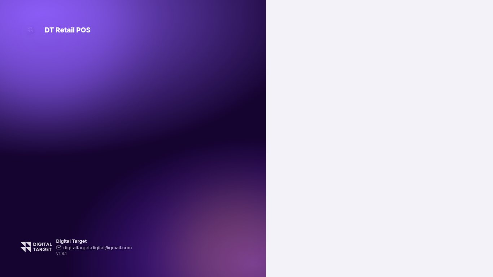

**Zaroori baatein:**
- Activation ke baad software yeh computer **yaad rakhta hai** — dobara key nahi poochta aur internet ke baghair bhi chalta hai.
- Software har chand minute mein provider se chupke se check karta hai (jab internet ho) ke license theek hai ya nahi.
- Agar license par **computers ki had** poori ho chuki hai to nayi computer **"approval ka intezar"** dikhati hai. Provider approve kar de to software khud khul jata hai (ya **Check again** dabayein).
- Agar provider license **Suspend / Block / Payment pending** kar de to lock screen par provider ka paigham dikhta hai aur wahin **chat box** hota hai — usi se provider ko likhein. Provider dobara active kar de to software khud khul jata hai, dobara activate karne ki zaroorat nahi.

| Screen par likha | Matlab | Kya karein |
|---|---|---|
| Waiting for approval | Is license par pehle hi sab computers lage hain | Provider se approve karwayein |
| Device suspended / blocked | Provider ne computer rok diya | Chat box mein ya phone par provider se baat karein |
| Payment pending | Provider ne payment ki yaad dahani rakhi hai | Payment karein, provider active kar dega |
| License expired | License ki muddat poori | Provider se renewal (nayi key) lein — **Settings → License** mein key daalein |
| Please fix the date | Windows ki date peeche kar di gayi thi | Windows ki date / time theek karein |

---

## 2. Login

Software khulte hi **Welcome back** screen aati hai. Apne naam ki tile par click karein aur **4 ankon wala PIN** dabayein. Username / password se bhi login ho sakta hai.

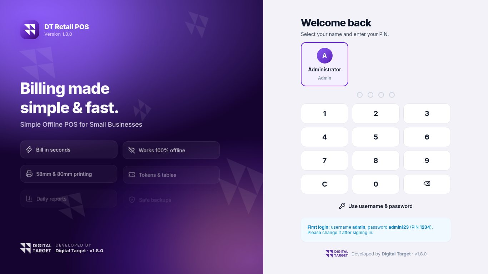

**Pehli dafa ka login:** `admin` / `admin123`, PIN `1234`.
**Sab se pehle yeh badlein:** **Users → Edit** (apne admin account par) mein naya password aur naya PIN. Jab tak default password hai, screen ke upar laal pattii yaad dilati rehti hai.

5 ghalat koshishon ke baad us username par **30 second** ke liye lock lag jata hai (hifazat ke liye).

---

## 3. Pehli setup (aadhe ghante ka kaam)

Yeh ek hi dafa karna hai. Is tarteeb se karein:

| # | Kahan | Kya karna hai |
|---|---|---|
| 1 | **Settings → Business** | Naam, address, phone, logo |
| 2 | **Settings → Receipt** | Bill ka design aur paper size |
| 3 | **Settings → Printers** | Printer chunein, test karein |
| 4 | **Settings → Sales & Tax** | Dine-In / Takeaway / Delivery, tax, order number |
| 5 | **Settings → Payments** | Quick cash buttons, bank accounts |
| 6 | **Settings → Tokens** | Token ka design |
| 7 | **Settings → Waiters & Riders** | Waiters aur riders ke naam |
| 8 | **Tables** | Tables aur floors |
| 9 | **Categories** aur **Products** | Menu (ya Excel se ek saath) |
| 10 | **Users** | Cashier / manager ke account |
| 11 | **Settings → Backup & Restore** | Backup ka folder / USB |

### 3.1 Business
**Settings → Business**: **Business name** (Urdu bhi chalta hai, jaise کراچی بریانی ہاؤس), **Tagline**, **Address**, **Phone**, **Email**, **NTN / STRN**, **Business type**, **Extra receipt line** (jaise "Home delivery: 0300-…") aur **logo**. Neeche **Save** dabayein.

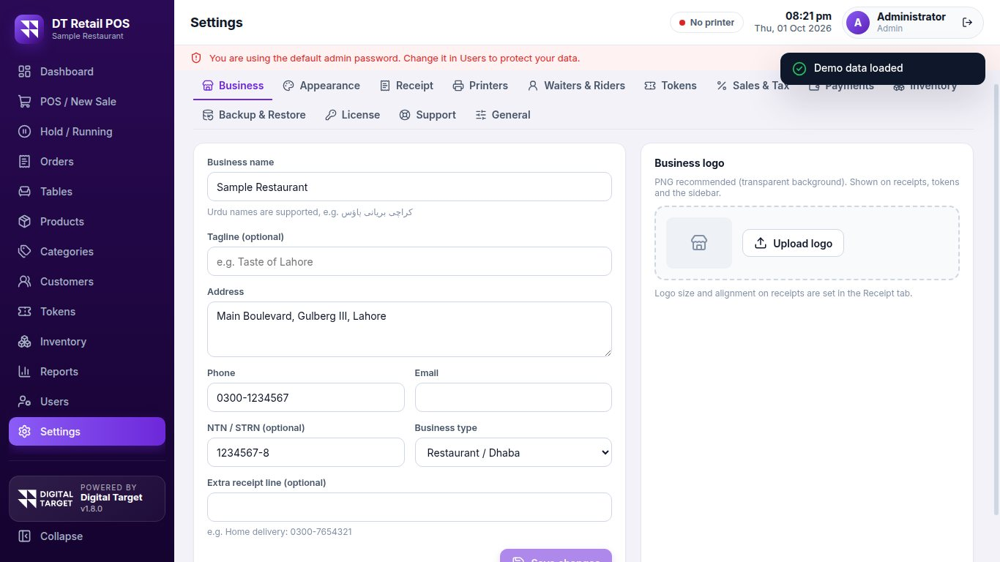

### 3.2 Receipt (bill ka design)
**Settings → Receipt** mein:
- **Paper width**: 58 mm ya 80 mm (apne printer ke mutabiq).
- **Design**: 11 designs hain — **Classic, Modern, Minimal, Restaurant, Retail Invoice, Compact, Boxed Grid, Bold Restaurant, Tax Invoice + QR, Luxury, Ticket**. Right side par **live preview** bilkul wesa hi hota hai jaisa print hoga.
- **Margins**: Top / Bottom, aur **Side margin** (left aur right hamesha barabar).
- **Font size, Font, Logo size, Logo align, Copies, Footer message**.
- On / off options: logo, order number, cashier, customer, table, payment details, discount breakup, NTN, item notes, **Compact mode**, **Amount in words**, "Powered by Digital Target".
- **QR code**: apni website / Google review / JazzCash number ka QR bill par.

Aakhir mein **Save & test print**.

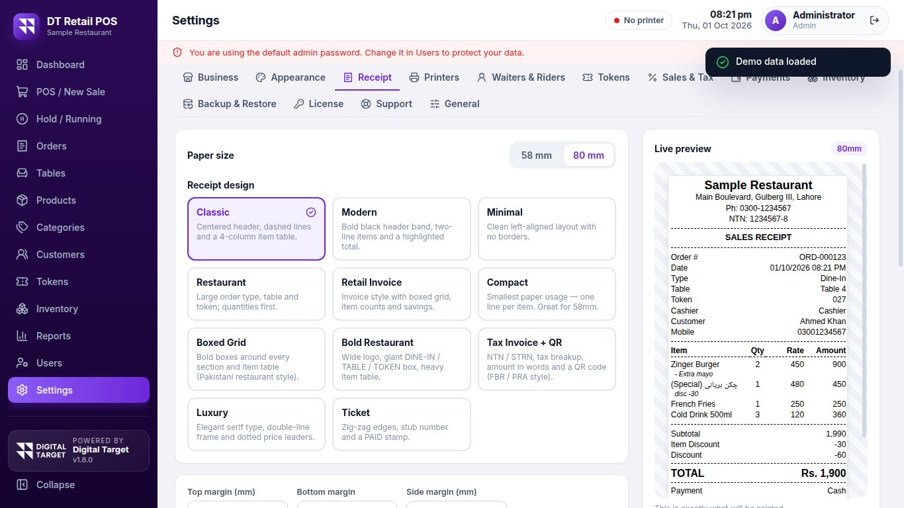

Kuch designs ka namoona:

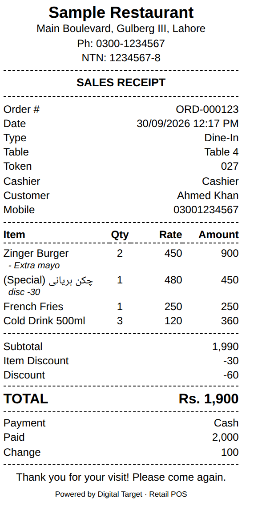  

### 3.3 Printers
**Settings → Printers**:
1. **Detect again** dabayein — Windows ke installed printers ki list aa jati hai.
2. **Receipt printer**: "Auto-detect thermal printer (recommended)" chhor dein ya apna printer chunein.
3. **Token / kitchen printer**: alag kitchen printer ho to chunein, warna "Same as receipt printer".
4. **Print method**: **Thermal — fast (recommended)** — bill seedha thermal printer ko jata hai: upar khali kagaz nahi, bilkul sahi lambai, sahi cut. Agar printer is tarah na chale to **Windows driver** chunein.
5. **Paper cut** (Partial / Full), **Extra feed (mm)**, **Print darkness**, **Side balance (dots)**, **Print width**.
6. **Print verification → Verify printers**: pehle bill se pehle check karta hai ke receipt aur kitchen printer jude hue aur tayyar hain.
7. On / off: **Print receipt automatically after payment**, **Print tokens automatically after payment**, **Open cash drawer when a receipt prints** (cash drawer printer ke RJ11 se laga ho).

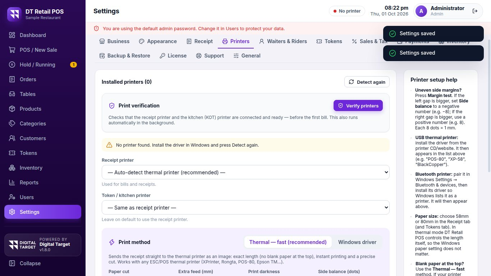

**Agar left / right margin barabar nahi:** **Margin test** dabayein. Left khali jagah zyada ho to **Side balance** mein minus number (jaise −8), right zyada ho to plus number (jaise 8) likhein. 8 dots = 1 mm.

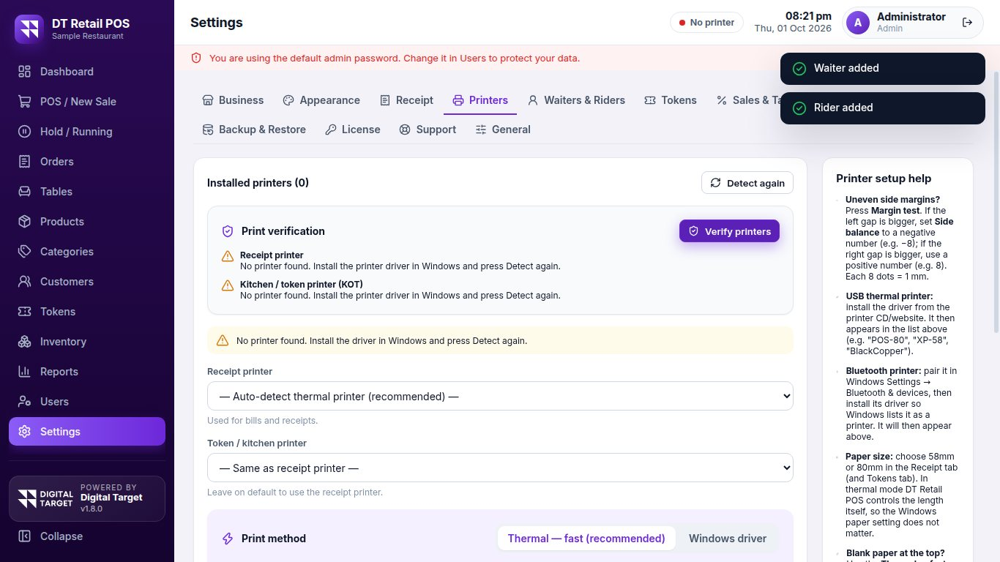

**Dhyan dein:** pehli dafa naye printer par **Test receipt** zaroor chalayein aur zaroorat ho to **Extra feed** / **Cut** theek karein.

### 3.4 Sales & Tax
**Settings → Sales & Tax**: **Dine-In**, **Takeaway**, **Delivery** on / off karein, **Default sale type**, **Default delivery charges**, **Order number prefix** (jaise ORD-) aur **digits**. **Charge tax** on karke **Tax label** (GST) aur **Tax rate (%)** likhein. **Round total to whole rupees** aur **Allow credit (unpaid) sales** bhi yahin hain.

### 3.5 Payments aur Bank accounts
**Settings → Payments**: **Quick cash buttons** (jaise 100, 500, 1000, 5000) — payment screen par nazar aate hain. **Bank accounts** mein **Bank name** (HBL, Meezan, JazzCash…), **Account title**, **Account number**, **IBAN**, **Branch** daalein. "Print bank account details on receipts" on karein to bill ke neeche account number chhap jata hai taake customer transfer kar sake.

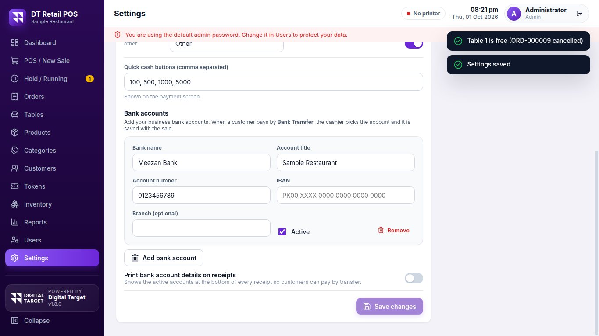

### 3.6 Tokens
**Settings → Tokens**: **Enable token system**, **Design** (Classic, Boxed, Bold Number, Minimal, Ticket), **Token title**, **Prefix**, **Digits**, **Paper width**, **Number size**, **Footer**, aur **Reset daily / Continuous**. Token par naam, items, prices, total dikhana ya chhupana yahin se hota hai.

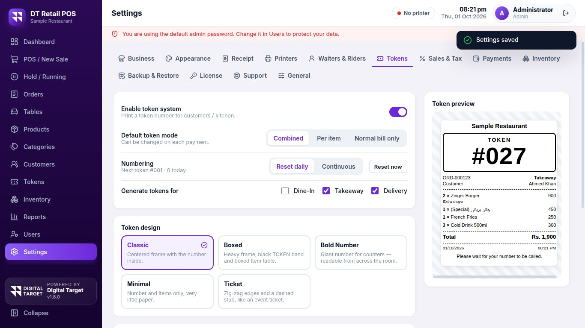

### 3.7 Waiters aur Riders
**Settings → Waiters & Riders**: **Name** likhein, **Waiter** ya **Rider** chunein, **Add** dabayein. POS par dine-in mein waiter aur delivery mein rider chuna ja sakta hai; naam bill, kitchen slip (KOT), token aur reports mein aata hai.

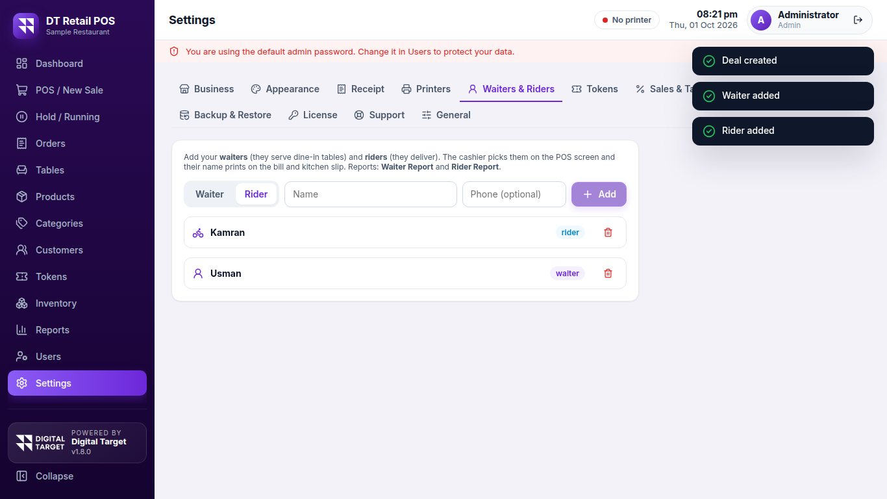

### 3.8 Tables
**Tables** screen par **Add Table** (ek table) ya **Add many…** (kai tables ek saath), **Manage** (naam badalna / delete), aur **Floors** (jaise Ground Floor, Garden). Tables ko floor mein daalne ke baad POS mein table chunte waqt woh floor ke hisaab se alag alag dikhte hain.

### 3.9 Users
**Users → Add User**: **Full name**, **Username**, **Password**, **PIN (4 digits)**, **Role** (Admin, Manager, Cashier, Kitchen, Delivery). Detail Section 9 mein hai.

### 3.10 Shakal aur General
- **Settings → Appearance**: 7 themes — **Royal Purple** (default), **Crimson Red & White**, **Black & Gold**, Emerald, Sunset, Ocean, Night. **Banner** (aaj ki offer ka title / text) aur **Smooth animations** (purane computer par band kar dein).
- **Settings → General**: **Show product images on POS**, **POS product size** (Small / Medium / Large), **Categories on POS** (Top / Left — Section 5.2), **Currency symbol**, **Change my password**.

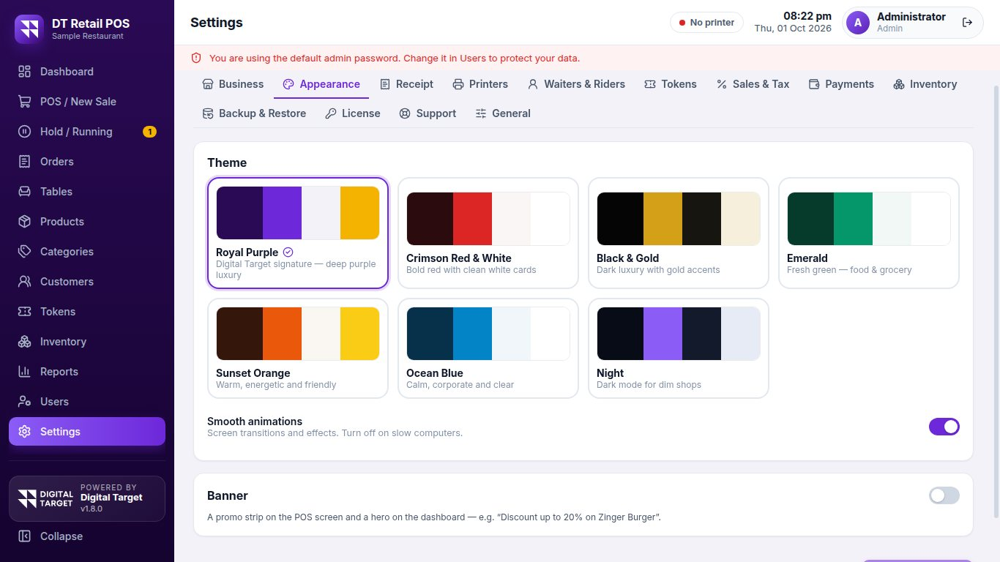

---

## 4. Menu banana

### 4.1 Categories
**Categories** screen: naam, **colour**, icon, sort order aur POS par dikhana / chhupana. Burgers, Biryani, BBQ, Karahi, Drinks wagaira.

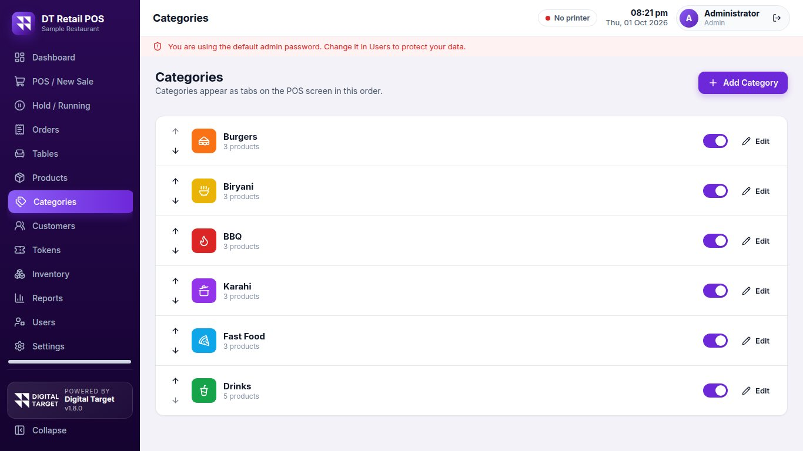

### 4.2 Product (item) add karna
**Products → Add Product**:

| Khana | Matlab |
|---|---|
| **Product name** (zaroori) | Item ka naam (Urdu bhi chalta hai, jaise زنگر برگر) |
| **Category / Unit** | Category aur unit (pcs, kg, litre…) |
| **Sale price** (zaroori) | Bechne ki qeemat |
| **Cost price** | Lagat (profit report ke liye; margin %) |
| **Discount per unit** | Har item par khud ba khud discount |
| **Code / SKU, Barcode** | Scanner se bechne ke liye |
| Tasweer | **Add image** — PNG / JPG khud chhoti ho jati hai |
| **Active** | POS par dikhana ya chhupana |
| **Track stock** | Stock ginna (opening stock, low stock alert) |

**Save Product** dabayein.

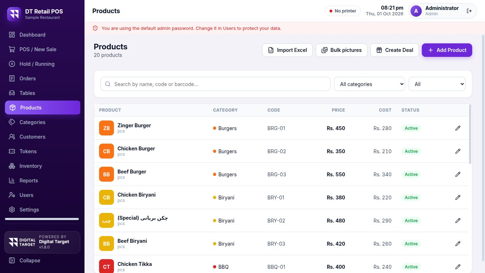

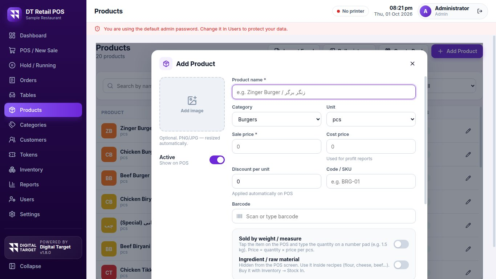

### 4.3 Size / Variants (Small – Medium – Large)
Product form mein **Variants (sizes)** → **Add size**: **Size name** (Small) aur **Price** likhein; jitne sizes chahiye utne add karein (jaise Pizza: Small 500, Medium 800, Large 1100). POS par us item par tap karne se **Choose a size** wali window aati hai; size chunte hi cart mein "Pizza (Large)" us ki apni qeemat ke saath jata hai. Card par "3 sizes" aur "from Rs. 500" likha nazar aata hai.

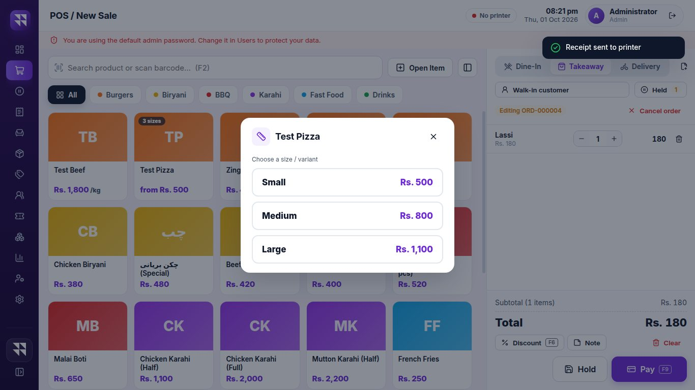

### 4.4 Kilo / gram par bikne wali cheez (Weighed item)
Product form mein **Sold by weight / measure** on karein (unit khud kg ho jata hai) aur **Sale price** = **ek kg** ki qeemat (jaise Beef Rs. 1,800 / kg).

POS par us item par tap karein to **right side par number pad** khulta hai:
- **By weight (kg)**: wazan likhein (jaise `1.5`) — qeemat khud ban jati hai: 1.5 kg × 1,800 = **Rs. 2,700**. Fori buttons: 0.25, 0.5, 1, 1.5, 2, 5.
- **By amount (Rs.)**: rupay likhein (jaise `900`) — wazan khud ban jata hai: Rs. 900 = **0.5 kg**.
- **Enter** (ya **Add to cart**) se cart mein chala jata hai. Gram tak darusti (1.375 kg).

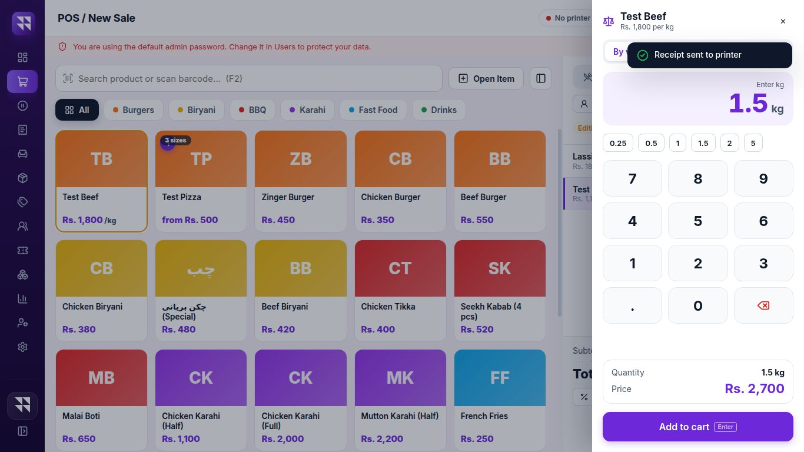
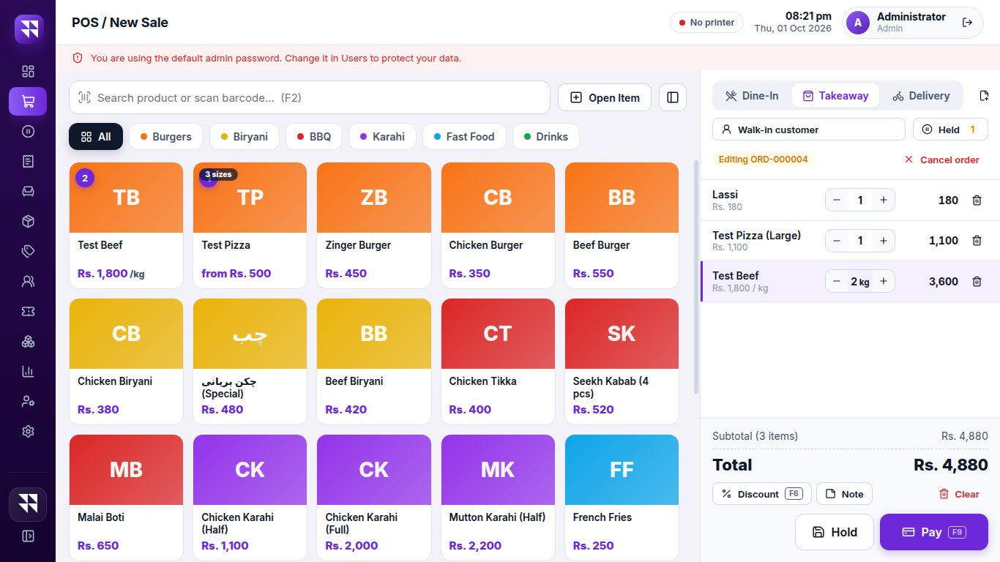

### 4.5 Recipe aur Ingredients (kharcha aur stock khud kam ho)
1. **Ingredient banayein:** Products mein khaam maal (aata, cheese, gosht…) ko product ki tarah banayein aur **Ingredient / raw material** on karein. Aisa maal POS ki screen par nahi dikhta. Is ka stock **Inventory → In** se khareedne par barhayein.
2. **Dish mein recipe daalein:** dish ka product kholein, **Recipe management** mein **Search an ingredient to add…** se maal chunein aur **ek (1) sale** mein jitni miqdar lagti hai likhein (jaise Dough 0.3 kg).
3. Ab har sale par software ingredient ka stock **khud kam** karta hai aur **Cost per sale** recipe se nikalta hai (profit report durust hota hai).
4. Sizes ke saath: har size ke saamne **× recipe** (recipe factor) likhein — Small 0.5, Medium 1, Large 1.5. Large pizza bikne par 0.3 × 1.5 = **0.45 kg** dough kam hota hai.

**Dhyan dein:** stock tabhi kam hota hai jab **Settings → Inventory → Enable inventory tracking** on ho aur product par **Track stock** on ho.

### 4.6 Deal / Combo
**Products → Create Deal**: deal ka naam (jaise "Family Deal"), **deal ki qeemat**, aur menu items search kar ke add karein (har item ki miqdar). **Save Deal**. POS par is par **DEAL** ka badge aur tafseel (1 × Zinger Burger + 1 × Mango Shake) nazar aati hai. Bikne par har component ka stock khud kam hota hai.

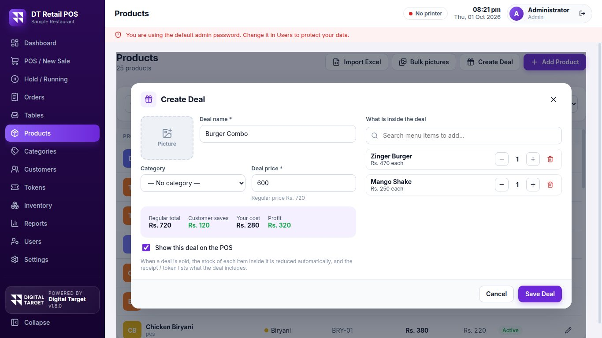
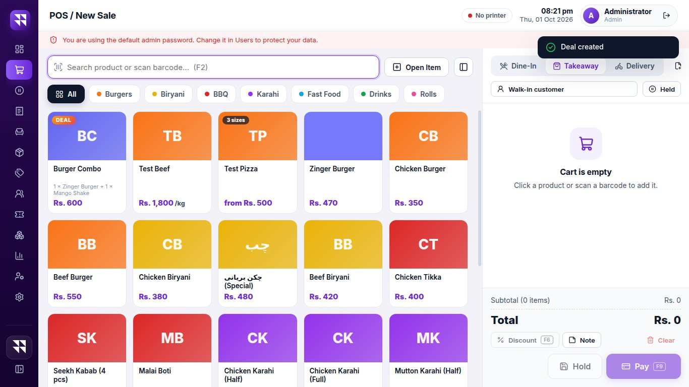

### 4.7 Poora menu Excel / CSV se ek saath
1. **Products → Import Excel** dabayein, **Download Excel template** se sample file lein.
2. File mein kam az kam **Name**, **Category**, **Price** columns rakhein (aur chahein to cost, discount, SKU, barcode, unit, stock). Categories khud ban jati hain.
3. File chunein — **preview** aata hai ("2 new", "1 updated"). **Import N items** dabayein.
4. Purani **.xls** file nahi chalti — Excel mein **Save As → Excel Workbook (.xlsx)** ya CSV karein.

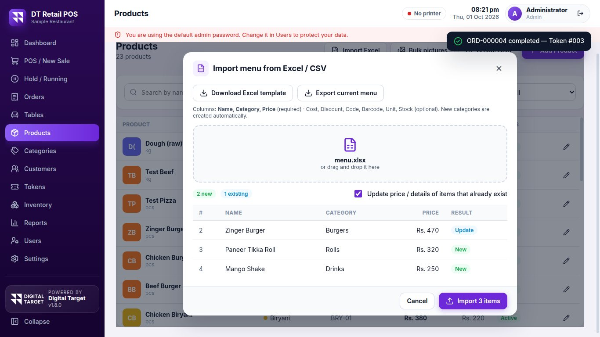

### 4.8 Bohat si tasveerein ek saath
**Products → Bulk pictures**: tasveeron ke file naam item ke naam par rakhein (`Zinger Burger.jpg`, `mango_shake.png`). Software naam milata hai ("3 matched") — **Add pictures** dabayein. Jo naam match na ho woh alag dikhaya jata hai.

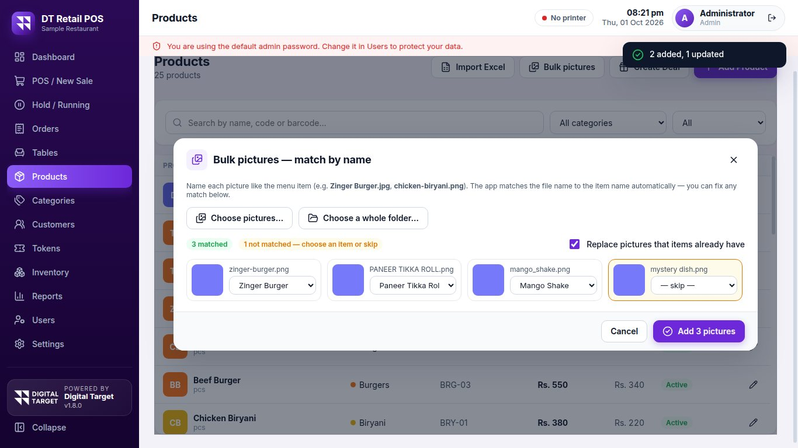

---

## 5. Rozana billing (POS)

### 5.1 POS screen ka naqsha
**POS / New Sale** — baayen taraf products, daayen taraf cart (bill):
- Upar **Search** (F2) — naam / SKU likhein ya barcode scan karein. Saath hi **Open Item** (jo menu mein nahi uski qeemat khud likh kar bechna).
- **Categories** — Section 5.2.
- Cart ke upar **Dine-In / Takeaway / Delivery**, customer, **Held** (rokay hue bills ki ginti).
- Cart ke neeche **Discount (F6)**, **Note**, **Clear**, **Hold** (F8), **Pay (F9)**.

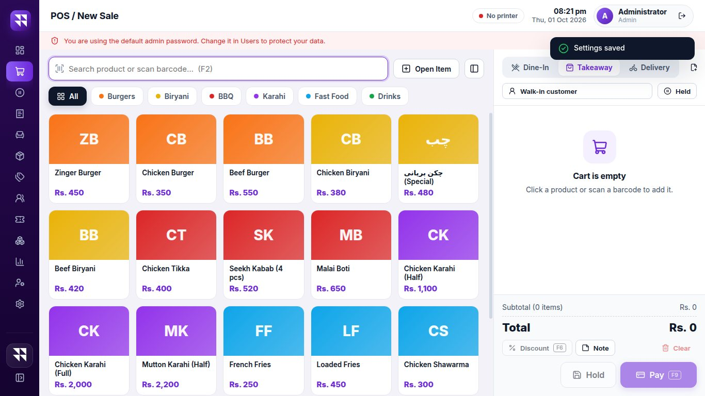

### 5.2 Categories ka do tarah ka layout
- **Top (default):** categories ek hi line mein. Jitni jagah ho utni dikhti hain, baqi **"⋯ +n"** button ke peeche — us par click karein to **jo categories line mein nahi aayin woh sab** ek list mein aa jati hain. Jo category chunein woh line mein aa jati hai.
- **Left:** categories **products ke baayen taraf ek seedhi list** mein. Is ke liye **Open Item** ke saath wala chhota button dabayein (ya **Settings → General → Categories on POS**). Wapas top karne ke liye wohi button.

(Yeh button sirf us user ko nazar aata hai jis ke paas Settings ki ijazat ho.)

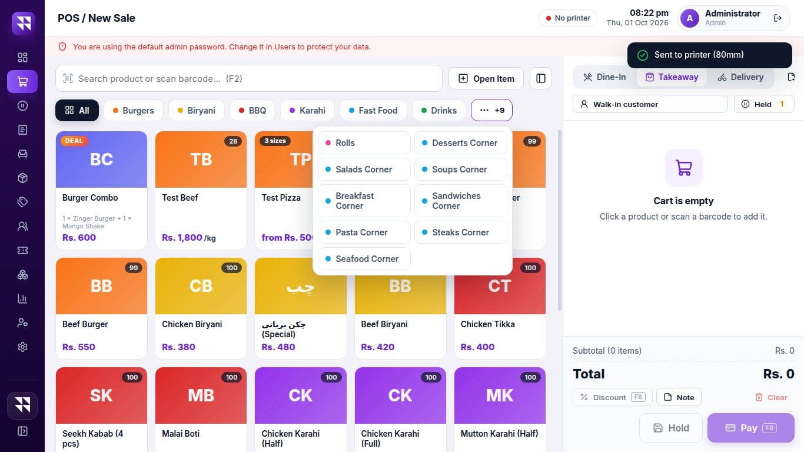
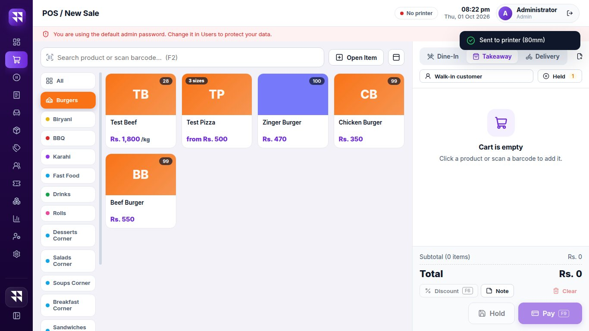

### 5.3 Takeaway sale (counter par)
1. Cart ke upar **Takeaway** chunein.
2. Items par click karein (har click par ek barhta hai). Cart mein **− / +** se miqdar badlein, **dustbin** se hataein. Variant / weight wale item par ooper bataya hua popup aayega.
3. **Pay (F9)** → rakam likhein → **Enter**. Bill aur token print ho jate hain. Customer ka naam optional hai.

### 5.4 Dine-In (table par)
1. **Dine-In** chunein → **Select Table** khulta hai (floors ke naam ke neeche tables). Khali (hara) table par click karein.
2. **Waiter** wale dabbe se waiter chunein.
3. Items add karein, phir:
   - **Save** (F8) — order **running** rakhein; kitchen ko **KOT** (kitchen slip) chali jati hai.
   - **Bill** (F10) — bill print karke customer ko dikhayein (order phir bhi khula rehta hai).
   - **Pay (F9)** — customer paise de to payment lein; table khud khali ho jati hai.
4. Table par aur cheezein mangwai jayein to **Tables** (ya **Hold / Running**) se us table par click karein → order cart mein khulta hai ("Editing ORD-…") → items barhayein → dobara **Save**.

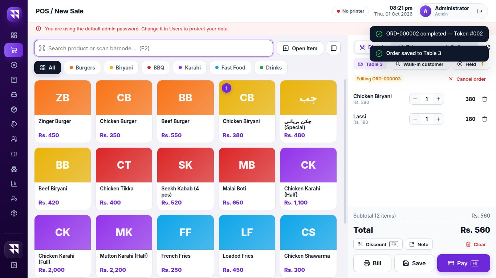

### 5.5 Delivery
1. **Delivery** chunein. Customer ki window aati hai: **naam, mobile, address** (zaroori), **Save**.
2. **Rider** wale dabbe se rider chunein; **delivery charges** bill mein khud jud jate hain (aap badal bhi sakte hain).
3. Items add karein → **Pay**. Order ke saath rider ka naam bill / report mein jata hai. Customer ki history **Customers** mein jama hoti hai.

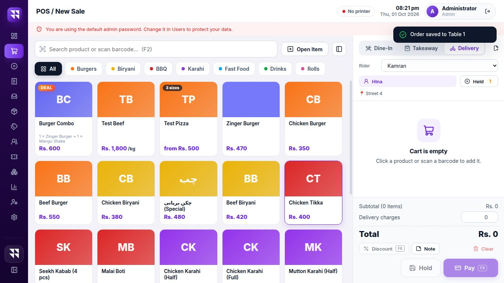

### 5.6 Discount, Note, Open Item
- **Discount (F6)**: poore bill par **Rs.** ya **%** mein. Har item par bhi discount lag sakta hai (item par click kar ke). Yeh sirf unhein milta hai jin ke paas "Give discounts" ki ijazat ho.
- **Note**: poore order ka note (jaise "Alag pack karein"). Har item ka apna note bhi ho sakta hai (kitchen slip par chhapta hai).
- **Open Item**: naam aur qeemat likh kar aisi cheez bechna jo menu mein nahi.

### 5.7 Payment (F9)
Payment window mein:
- **Cash / Card / Bank / Other** chunein.
- **Amount Received** likhein ya **quick cash buttons** (jaise 1000, 5000) / **Exact** dabayein. **Change** khud nikalta hai.
- **Bank** chunein to **Paid into account** mein woh account chunein jis mein paise aaye (bill par bhi chhapta hai).
- **Credit (udhaar):** poori rakam na lein to baqi **Due (Credit)** ban jati hai. Is ke liye customer ka naam zaroori hai aur **Settings → Sales & Tax → Allow credit** on hona chahiye. Baad mein **Orders → Receive due** se baqaya wasool karein.
- **Token:** **Combined** (ek token), **Per Item** (har item ka alag), **No Token**.
- **Print receipt** ka dabba.
- **Enter** dabane se sale mukammal.

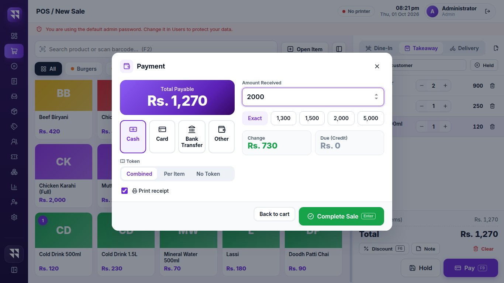
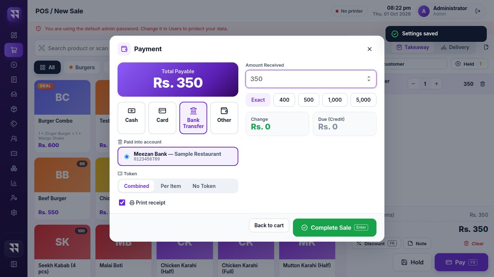

### 5.8 Sale ke baad
Hara nishaan aur token number dikhta hai. Yahan se **Print receipt**, **Print token**, **Save PNG** (bill ki tasveer WhatsApp ke liye) kar sakte hain. "Ready for the next customer" — agla bill shuru karein.

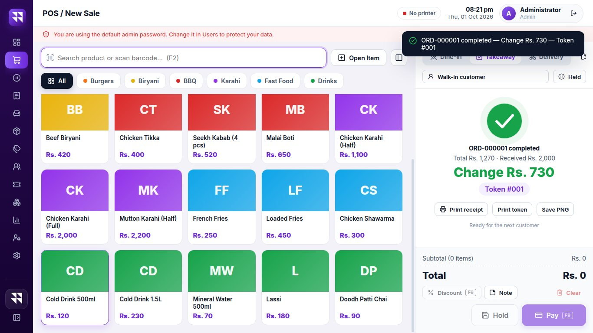

### 5.9 Keyboard shortcuts

| Key | Kaam | Key | Kaam |
|---|---|---|---|
| **F2** | Search / barcode | **F8** | Hold / Save order |
| **F3** | Naya order | **F9** / Ctrl+Enter | Payment |
| **F4** | Customer | **F10** | Bill save + print (dine-in) |
| **F6** | Bill discount | **Enter** (payment mein) | Sale mukammal |
| **F7** | Held orders | **Del / + / − / ↑ ↓** | Item hataein / miqdar / cart mein upar neeche |

**Barcode scanner:** USB scanner keyboard ki tarah chalta hai — Search box mein scan karein, **Enter** par item cart mein aa jata hai (barcode ya SKU se).

---

## 6. Hold / Running, Orders, Tables, Tokens, Customers

### 6.1 Hold / Running
Sidebar ka **Hold / Running**: jo bills **Hold** kiye (takeaway) aur jin dine-in tables ka bill abhi chal raha hai — sab ek jagah. Filters: **Running (Dine-In)**, **On Hold (Takeaway)**, **Delivery**. Har card par:
- **Retrieve** — POS par dobara kholein.
- **KOT** (topi ka nishaan) — kitchen slip dobara.
- **Printer** — bill print.
- **Cancel** (laal ✕) — order cancel.

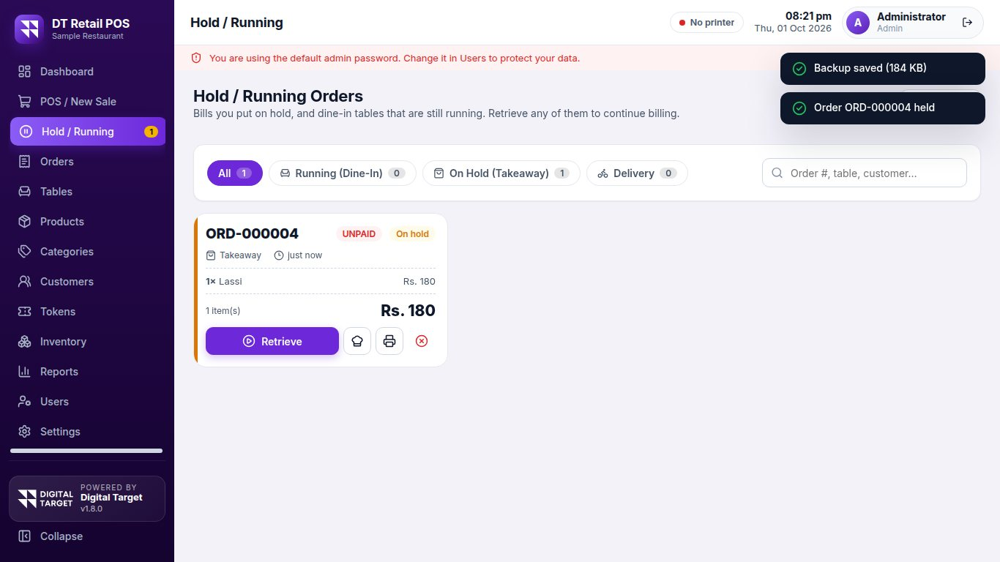

### 6.2 Orders
**Orders**: order #, customer, mobile, token ya table se search; tareekh, status, type, payment ke filter. Order par click karein to tafseel khulti hai:
- **Print receipt**, **KOT**, **Generate token** / **Print token** (reprint).
- **Receive due** — udhaar ki rakam wasool karna.
- **Cancel order** — jo abhi pending ho.
- **Refund** — mukammal order wapas (stock wapas jama ho jata hai).
- **Open in POS**.

(Cancel / Refund ki ijazat sirf unhein hoti hai jin ke paas "Cancel / refund orders" ho.)

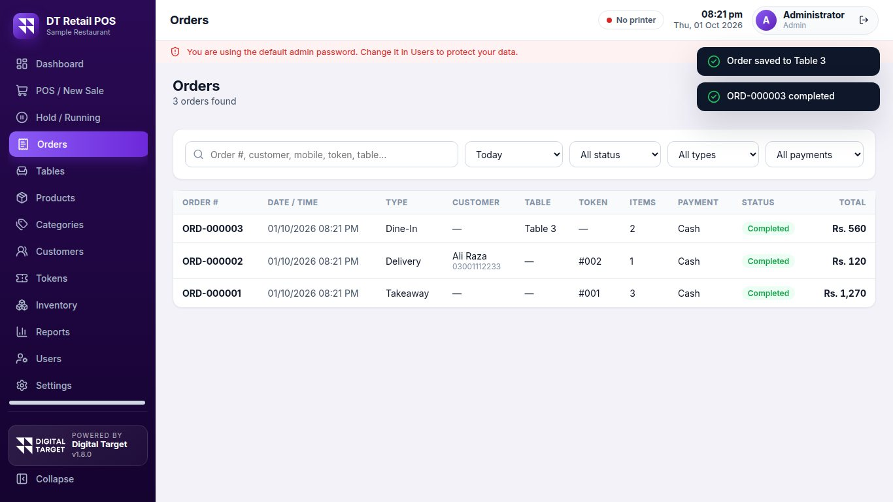

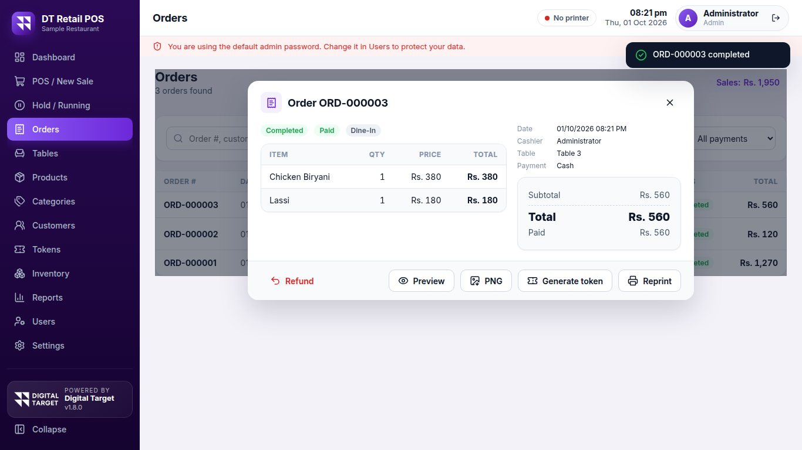

### 6.3 Tables
**Tables** ek floor plan ki tarah hai: hara = khali, laal = bill chal raha hai (order number, shuru ka waqt, total), peela = reserved. Upar floors ke tabs (All floors / Ground Floor / Garden…).
- Khali table par click = naya dine-in order. Laal table par click = uska bill.
- Laal table ke buttons:
  - **Move** — order doosri khali table par.
  - **Merge** — kai tables ka bill ek mein jorna.
  - **Split** — bill mein se kuch items doosri table / bill par alag karna.
  - **Free** (rubber ka nishaan) — table khali karna. **Dhyan dein:** is se us table ka chalta hua bill **cancel** ho jata hai; bill bachana ho to **Move** istemaal karein.
  - Khali table par **Reserve**.
- **Floors** se naye floors; **Manage** se tables ka naam / delete.
- **Dine-in history** tab: purane dine-in bills.

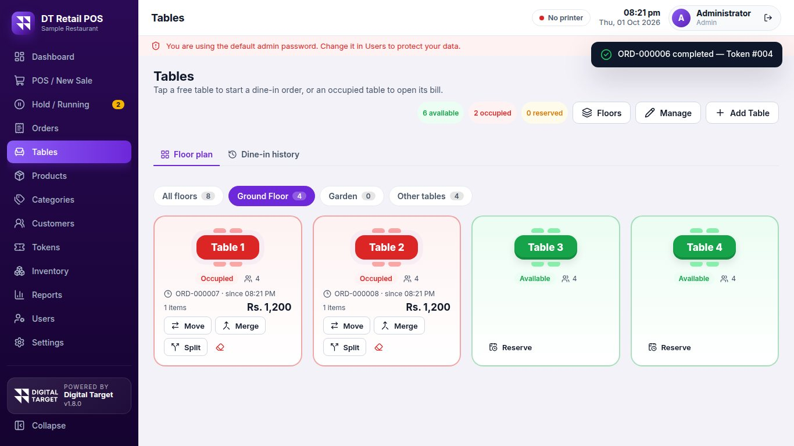

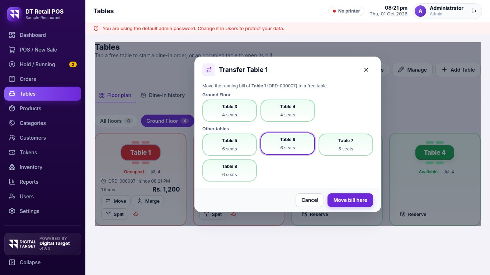
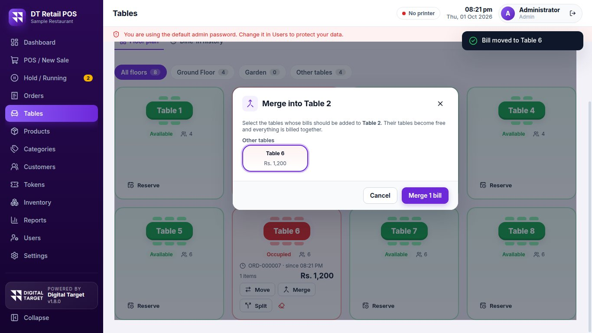
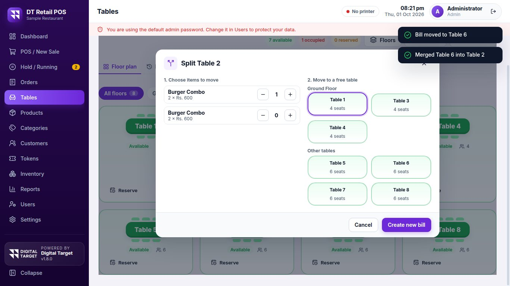

### 6.4 Tokens
**Tokens** kitchen / counter board hai: har token **Preparing → Ready → Collected**. Numbers roz 001 se shuru (ya **Continuous** — Settings → Tokens). **Reset counter** se number dobara 1 se.

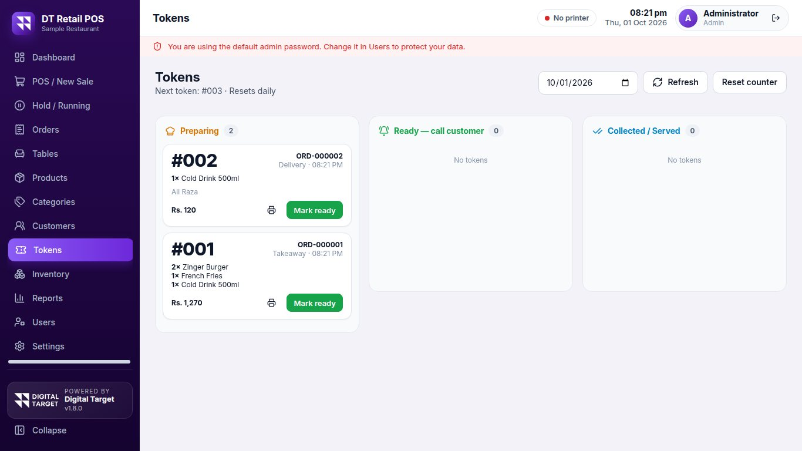

### 6.5 Customers
**Customers → Add Customer**: naam, mobile, address, note. Delivery aur udhaar ke customers khud ban jate hain. Har customer ki khareed ki history, kul kharch aur **baqaya (Due)** nazar aata hai.

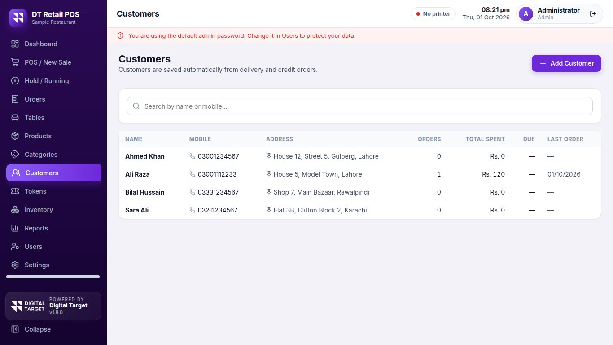

---

## 7. Inventory (stock)

1. **Inventory** kholein → **Enable inventory** (ya **Settings → Inventory → Enable inventory tracking**). Band ho to POS normal chalta hai, bas stock kam nahi hota.
2. **Settings → Inventory → Allow selling when out of stock** — restaurant ke liye on rakhna behtar hai (stock khatam hone par bhi bechna band na ho). Off karein to stock se zyada ki sale rok di jati hai.
3. Har item ke saamne:
   - **In** — maal aaya (stock barhao; average cost khud nikalta hai).
   - **Out** — maal nikala (kharab / ghar ke liye).
   - **Adjust** — ginti ke baad asal miqdar likhna.
4. **Stock History** tab: har tabdeeli ka record.
5. Upar ke dabbe: Tracked products, **Stock value**, **Low stock**, **Out of stock**. Low stock ki had har product mein **Low stock alert at** se.

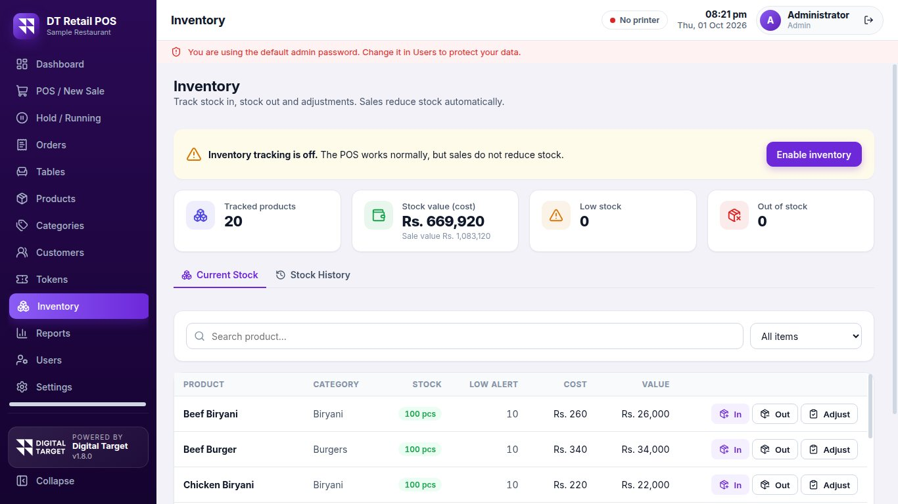

---

## 8. Reports

**Reports** mein aap tareekh chun kar yeh reports dekh sakte hain:

| Group | Reports |
|---|---|
| Sales | **Day Summary (Z Report)**, Sales Report, Order Report, Dine-In / Takeaway / Delivery Sales |
| Items | Product Sales, Category Sales |
| Money | Payment Report, Credit / Due Report, Discount Report, Profit Report |
| Staff | Cashier Report, Waiter Report (dine-in), Rider Report (delivery) |
| Stock | Inventory Report, Stock Movements |

Har report ko **Print**, **PDF**, **CSV**, **Excel (.xlsx)** mein nikala ja sakta hai, aur **80 mm / 58 mm thermal printer** par chhota karke print ya **PNG** mein save bhi (Preview → Print 80mm / Save PNG).

**Din ke aakhir mein:** **Day Summary (Z Report)** nikalein — kul sale, cash / card / bank, discount, udhaar, order types sab ek parchi mein; cash ginti isi se milayein.

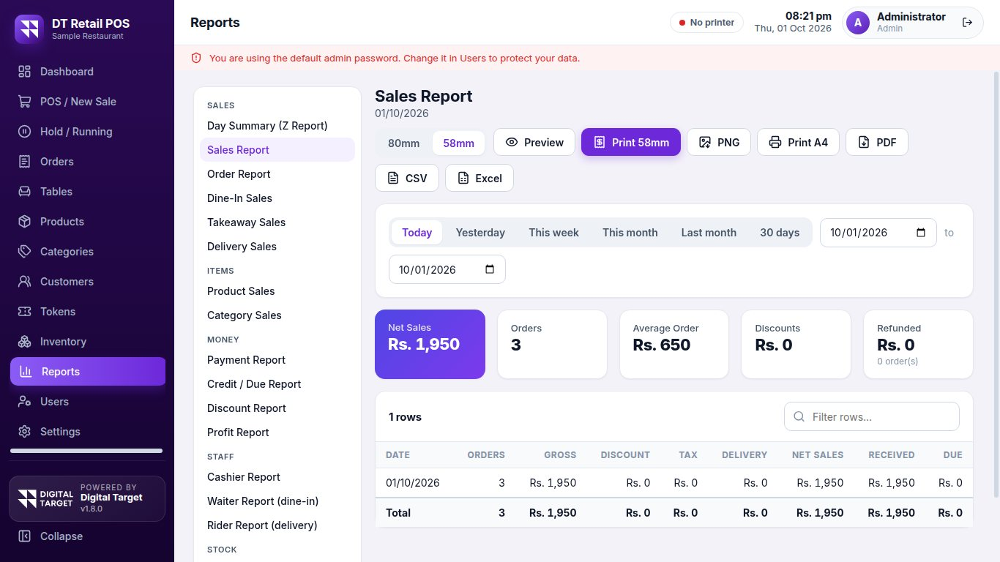
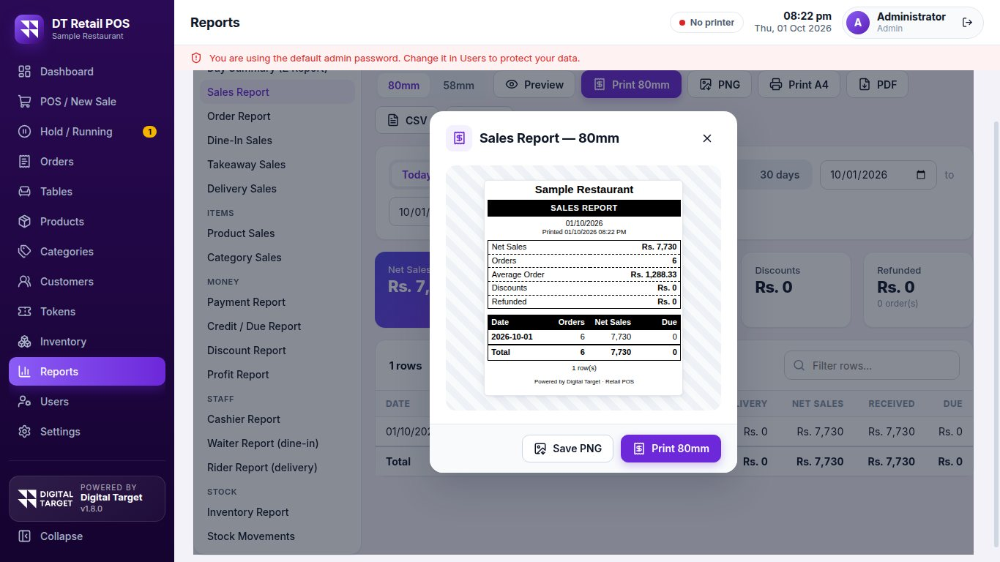

**Dashboard** (sab se pehli screen, admin / manager ke liye): aaj ki sale, orders, profit, cash / card / bank, udhaar, dine-in / takeaway / delivery ka hissa, pending orders, bhari hui tables, low stock, top items aur charts.

---

## 9. Users aur ijazatein (Permissions)

**Users → Add User** — **Full name, Username, Password, PIN (4 digits), Role**. Role se ijazatein khud lagti hain; zaroorat ho to **custom checkboxes** se alag se chun sakte hain. "Remove PIN login" se PIN login band hota hai.

| Role | Kya kar sakta hai |
|---|---|
| **Admin** | Sab kuch (Users, Settings, Backup, Reports…) |
| **Manager** | Dashboard, POS, Orders, Tables, Products, Categories, Customers, Tokens, Inventory, Reports, discount, cancel / refund |
| **Cashier** | POS, Orders, Tables, Customers, Tokens, discount |
| **Kitchen** | Tokens, Orders |
| **Delivery** | Orders, Customers |

Cashier ko **Settings, Users, Reports** nazar hi nahi aate (neeche tasveer). Har sale par cashier ka naam, tareekh aur waqt save hota hai.

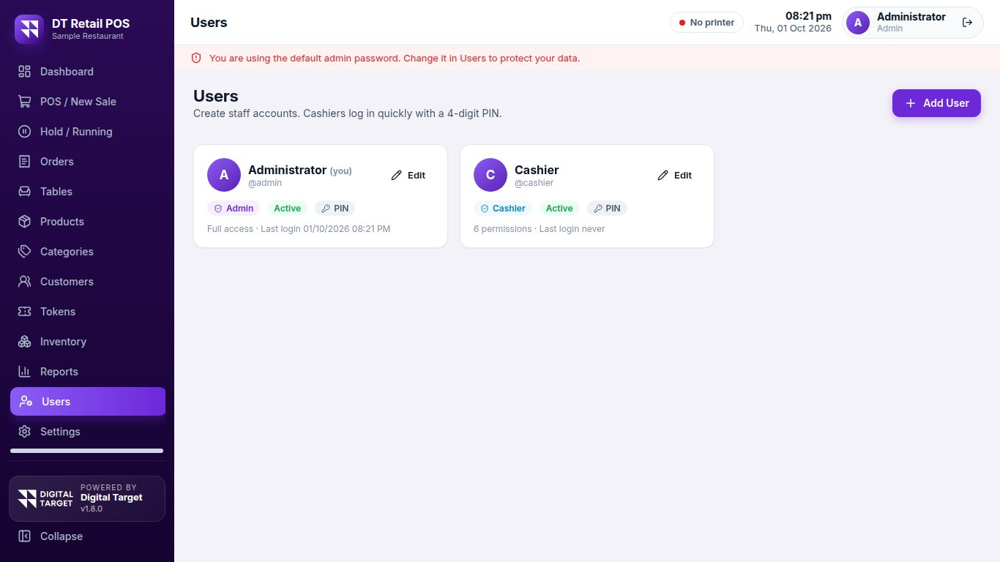
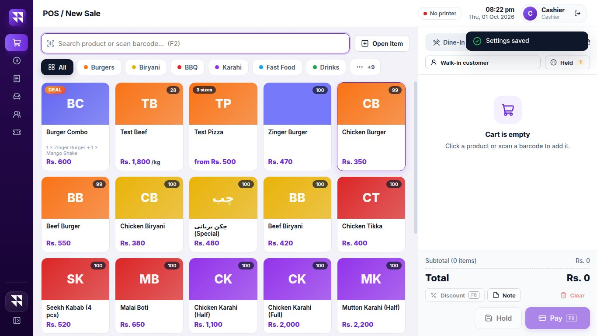

---

## 10. Backup, Restore aur Export

**Aap ke data ki hifazat sab se zaroori hai** — kam az kam roz ek backup USB par rakhein.

### 10.1 Backup
**Settings → Backup & Restore**:
- **Backup now** — usi waqt backup.
- **Backup to USB / folder…** — USB ya Google Drive wale folder mein.
- **Automatic daily backup** — din mein ek dafa khud (software khula ho to). **Keep automatic backups** mein tadaad likhein (purane khud delete).
- Upar "Last backup" mein aakhri backup ka waqt; 3 din se purana ho to peeli warning.

### 10.2 Restore
**Restore from file…** (ya list mein kisi backup ke saamne **Restore**): purane backup se data wapas. Restore se pehle **maujooda data ki safety copy** khud ban jati hai, phir software dobara khulta hai. Restore karne se **license nahi hatta** (alag file mein hai).

### 10.3 Excel ya JSON mein poora data (Export / Import)
Isi screen par **Export / import all data**:
- **Export Excel (.xlsx)** — har table ki alag sheet (menu, tasveerein, orders, customers, users, settings…). Excel mein khol kar dekh / edit bhi sakte hain.
- **Export JSON** — wohi data JSON file mein.
- **Import Excel / JSON…** — file chunein; software batata hai kitne products / orders hain; **Replace all data & restart** dabayein. **Saara maujooda data is file se badal jata hai** (pehle safety backup banta hai). Agar file kharab ya adhoori ho to **kuch nahi badalta**.

**Ehtiyat:** is file mein aap ki sales aur users ke account hote hain — kisi ko na dein. Rozana hifazat ke liye **Backup now** zyada tez aur mehfooz hai.

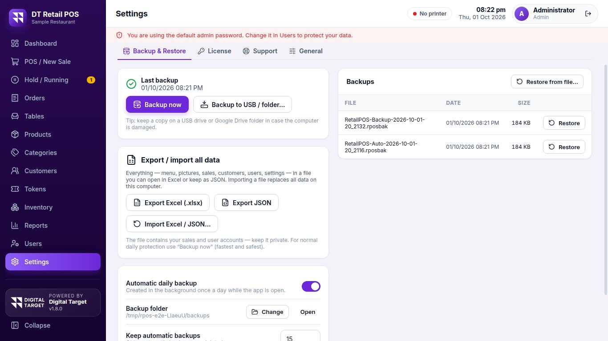

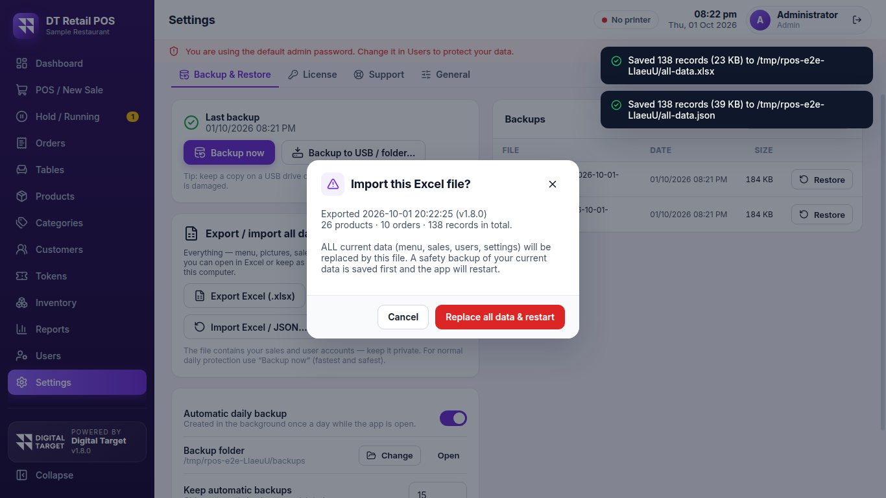

### 10.4 Naya computer / Windows dobara
1. Purane computer par **Backup to USB**.
2. Naye computer par software install, provider se license / **Transfer** karwayein, activate karein.
3. **Restore from file…** se USB wala backup chunein.

Data folder dekhne ke liye: **Settings → General → Open data folder** (log files ke liye **Open logs**).

---

## 11. License, Support aur Location

**Settings → License**: license ki halat (Active / Expired…), kis ke naam, plan, expiry (kitne din baqi), max users, devices ki had, **Computer ID**, aakhri online check. Naya / renewal key **Update / renew license** mein daalein.

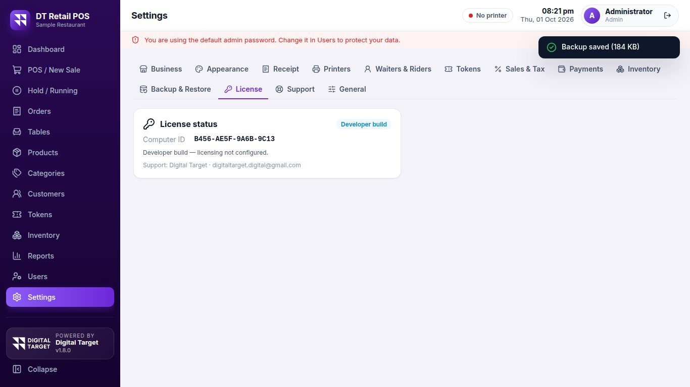

**Settings → Support**: provider (Digital Target) ko seedha paigham likhein, jawab usi mein aata hai — sidebar / tab par "✉ new message" ka nishaan. Internet chahiye.

**Device location:** **Settings → License** mein "Device location" ka card hai — provider apni map mein aap ki computer ki jagah dekh sakta hai (support aur tahaffuz ke liye). Har login par khud bhej diya jata hai; **Send my location now** se abhi bhi bhej sakte hain. Sahi (exact) jagah ke liye Windows mein **Settings → Privacy → Location** on aur "Let desktop apps access your location" on hona chahiye; warna sirf internet se andaza hoga.

---

## 12. Din ki checklist

**Subah (kholte waqt)**
1. Computer on, software kholein, apne PIN se login.
2. Printer on, kagaz check; **Settings → Printers → Verify printers** (ya status pill hara ho).
3. Aaj ki offer ho to **Settings → Appearance → Banner**.
4. Zaroorat ki cheezon ka stock (**Inventory**).

**Din mein**
- Dine-In: table → items → **Save** (KOT kitchen ko) → baad mein **Pay**.
- Takeaway / Delivery: items → **Pay**. Rukna ho to **Hold**.

**Raat (band karte waqt)**
1. **Hold / Running** check karein — koi bill reh to nahi gaya.
2. **Reports → Day Summary (Z Report)** print; cash ginti milayein.
3. **Backup now** aur USB par copy.
4. Software band karein, phir computer band.

---

## 13. Masail aur unke hal

| Masla | Hal |
|---|---|
| Status mein **No printer** (laal) | Printer on / USB laga hai? Windows mein driver install? **Settings → Printers → Detect again**, phir **Verify printers**. |
| Bill ke upar khali kagaz | **Print method** ko **Thermal — fast** rakhein; **Extra feed** kam karein; **Top margin** 1 mm. |
| Print left ya right taraf khisak raha hai | **Margin test** → **Side balance** (Section 3.3). |
| Cut theek jagah nahi | **Paper cut** (Partial / Full) aur **Extra feed** badlein. |
| Urdu naam bill par ulta / toota | Dubara **Save & test print**; **Thermal** method Urdu bhi theek chapta hai. |
| Cash drawer nahi khulta | **Open cash drawer when a receipt prints** on karein; drawer printer ke RJ11 se laga ho; dubara chhapne (reprint) par drawer nahi khulta. |
| "License required" / lock screen | Section 1.3 ki table dekhein; lock screen ke chat se provider ko likhein. |
| Software khulte hi activation maangta hai | Naya computer / Windows dobara — key daalein ya provider se **Transfer** / approve karwayein. |
| Stock minus mein ja raha hai | **Settings → Inventory → Allow selling when out of stock** — restaurant ke liye on rehna theek; stock **Inventory → In** se bharein. |
| Credit sale nahi ho rahi | Customer ka naam likhein aur **Settings → Sales & Tax → Allow credit** on karein. |
| Excel import mein "Old .xls" ka paigham | Excel mein **Save As → .xlsx** ya CSV. |
| Cashier ko menu nazar nahi aate | Admin **Users → Edit** mein role / ijazatein badal sakta hai. |
| Password bhool gaye | Doosra Admin **Users → Edit** se naya password de. Agar sab Admin bhool gaye to Digital Target support se rabta karein. |
| Screen safed / ruk gayi | Software band kar ke dobara kholein. Dobara ho to **Settings → General → Open logs** ka folder provider ko bhej dein. |
| Sab kuch ghalat ho gaya | **Restore from file…** se pichla backup (restore se pehle safety copy khud ban jati hai). |

---

## 14. Aam sawal

**Kya internet ke baghair chalta hai?** Haan — billing, printing, reports sab. Internet sirf pehli activation, provider ke paigham aur license ke online check ke liye.

**Kya data kisi aur ko jata hai?** Nahi. Menu, sales, customers sirf aap ke computer par hain. Provider ko sirf license / computer ki maloomat (naam, Windows, IP, jagah) jati hain.

**Ek license par kitne computer?** Jitne provider ne license mein tay kiye (3 ya 5 wagaira). Zyada ke liye provider se approval.

**Urdu likh sakte hain?** Haan — product, category, customer, business name sab Urdu mein; bill par bhi Urdu font embedded hai.

**Kya 58 mm aur 80 mm dono?** Haan — **Settings → Receipt → Paper width** (aur Tokens mein alag).

**Bill ki tasveer WhatsApp par?** Sale ke baad **Save PNG**.

**Printer badal diya?** **Settings → Printers → Detect again**, naya printer chunein, **Test receipt**.

---

# Appendix A — Super Admin panel (sirf provider ke liye)

Yeh hissa **Digital Target / software dene wale** ke liye hai. Restaurant ke staff ko is ki zaroorat nahi. Panel ek web page hai (Firebase par), head admin: `digitaltarget.digital@gmail.com`.

### A.1 Ek dafa ki setup
1. `cd superadmin && npm install && npx firebase-tools login && npx firebase-tools deploy` — **har naye version ke baad dobara deploy** zaroori hai (security rules update hote hain; warna location / nayi cheezein kaam nahi karti).
2. Firebase Console mein **Authentication → Email/Password** on, head admin account banayein, email verify karein.
3. Panel mein login → **Settings → Create signing key**. Isi se public key khud publish hoti hai (POS khud download karta hai).

Tafseel: `docs/SUPER_ADMIN_SETUP.md`.

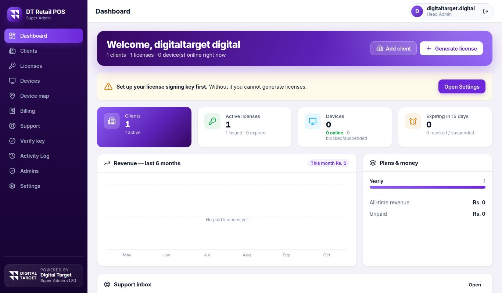

### A.2 Client aur License banana
1. **Clients → Add client** (business, owner, phone / WhatsApp, city…) ya seedha **Licenses → Generate license** mein **+ New restaurant** (naam, owner, phone ek form mein).
2. Plan chunein (Trial / Monthly / Quarterly / Half-yearly / Yearly / Lifetime / Custom), expiry, **max users**, **max devices** (kitne computer), qeemat / paid.
3. **Online device registration** (tajweez shuda) — Computer ID ki zaroorat nahi.
4. Key do shaklon mein milti hai: **chhoti `DTPOS-XXXX-XXXX-XXXX-XXXX`** (aam) aur lambi `RPOS1…` (bina internet wale computer ke liye). **Copy WhatsApp message** se client ko bhej dein.

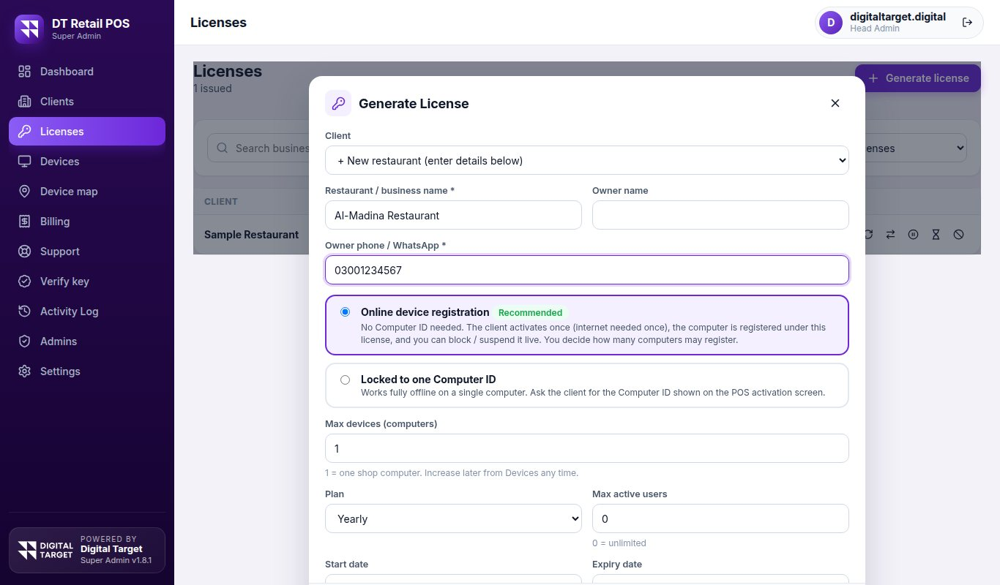

### A.3 Devices (computers) ka control
**Devices**: har register computer (online nishan, last seen, Windows / POS version). **Block / Unblock**, **Suspend / Activate**, **Remove**. **ⓘ** se poori tafseel: naam, model, CPU, RAM, local / public IP, shehar, coordinates, owner. Tabdeeli POS ko takreeban **ek minute** mein lagti hai (jab online ho). Limit se zyada computer par **Device approval needed** ka alert — **Approve** (computer register aur limit barhti hai) ya **Reject**.

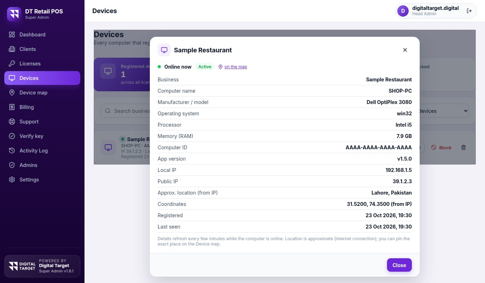

### A.4 Device map
**Device map**: sab computers ki jagah. **Exact** (computer ki Windows location) pehle, warna **dashed pin** IP se andaza. **Place** → map par click kar ke aap khud bhi sahi jagah laga sakte hain.

### A.5 Support, Billing, Verify
- **Support**: client ke paigham ek inbox mein (dashboard aur sidebar par badge); jawab likhein.
- **Billing**: invoices banayein, preview, A4 print; har invoice par **verify QR / code** — koi bhi public page par dekh sakta hai ke invoice asli hai.
- **Verify key**: koi key paste kar ke dekhein asli / expiry kya hai.
- **Activity Log**: har tabdeeli ka record; head admin purani entries (30 / 90 din / sab) saaf kar sakta hai.
- **Admins**: head admin extra admin shamil karta hai.

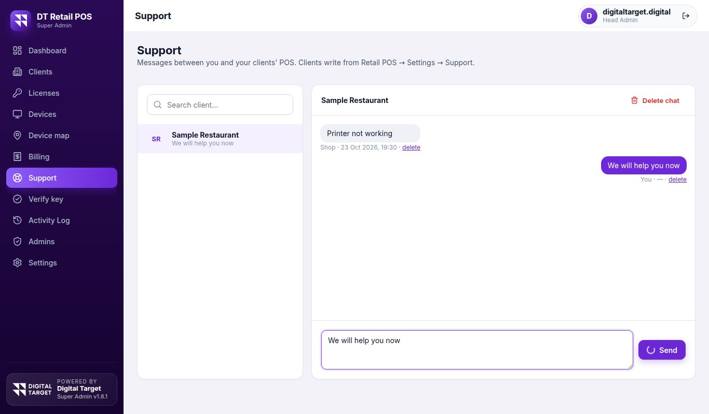

### A.6 Dhyan dein
- License ki tabdeeli (block / suspend / renew) POS tak **internet par** hi pohanchti hai; hamesha offline computer license ki expiry tak chalta rahega — isi liye plans muddat wale (jaise saalana) rakhein.
- Hamesha private signing key ka backup (Settings) mehfooz rakhein.

---

**Madad:** Digital Target — digitaltarget.digital@gmail.com · Software ke andar **Settings → Support** se bhi likh sakte hain.
